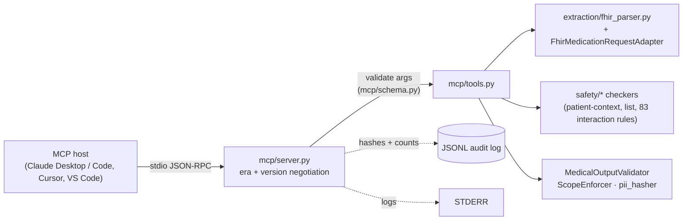
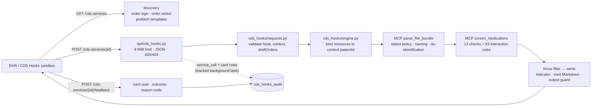

# ARCHITECTURE.md — medagent-core System Architecture

## Overview

`medagent-core` is a safety-first clinical AI reasoning agent built around an explicit finite state machine. Unlike black-box LLM wrappers, every reasoning step is logged, every state transition is validated, and every output carries a mandatory audit trail.

```
┌─────────────────────────────────────────────────────────┐
│                    FastAPI REST Layer                    │
│         /analyze  /drug-interactions  /health           │
│   /cds-services (HL7 CDS Hooks 2.0, deterministic only) │
└───────────────────────┬─────────────────────────────────┘
                        │
┌───────────────────────▼─────────────────────────────────┐
│             ClinicalAgentStateMachine                    │
│                                                          │
│  INTAKE ──► ENTITY_EXTRACTION ──► KNOWLEDGE_RETRIEVAL   │
│                                          │               │
│            ┌─────────────────────────────▼              │
│            │         REASONING                          │
│            └──────────────┬────────────────────         │
│                           │                             │
│                    SAFETY_CHECK                         │
│                  ┌────────┴────────┐                    │
│              OUTPUT           ESCALATE                  │
│                                                          │
│                    ERROR (any state)                    │
└──────────────────────────────────────────────────────────┘
```

---

## Module Map

```
src/medagent/
├── config.py          # Pydantic-settings: all env vars in one place
├── models.py          # Frozen Pydantic domain models (ClinicalQuery, ClinicalReasoning, …)
├── logging_config.py  # structlog JSON logging configuration
│
├── agent/
│   ├── state_machine.py   # ClinicalAgentStateMachine — state transitions
│   └── audit.py           # SQLAlchemy async audit log (persist_run, fetch_run)
│
├── extraction/
│   ├── ner.py             # EntityExtractor: scispaCy NER + regex fallback
│   └── fhir_parser.py     # FHIR R4 Bundle → FHIRPatientContext; PII hashing at boundary
│
├── retrieval/
│   ├── pubmed.py          # PubMed ESearch/EFetch async client (tenacity retries)
│   ├── drug_interaction.py # DrugInteractionClient: RxNorm + OpenFDA dual-source validation
│   ├── local_kb.py        # LocalKnowledgeBase: BM25 + dense hybrid retrieval
│   └── orchestrator.py    # RetrievalOrchestrator: parallel fan-out + deduplication
│
├── reasoning/
│   ├── bayesian.py        # bayesian_score, rank_hypotheses, calibrate_confidence
│   └── engine.py          # ReasoningEngine: LLM prompt → Hypothesis list
│
├── llm/
│   ├── base.py            # BaseLLMAdapter ABC + LLMResponse dataclass
│   ├── adapters.py        # OpenAI, Anthropic, Google, Kimi concrete adapters
│   ├── router.py          # MedicalRouter: task-to-provider routing with fallback chain
│   └── validator.py       # MedicalOutputValidator: prohibited content detection
│
├── safety/
│   ├── disclaimer.py      # Mandatory disclaimer strings + MEDICAL_SYSTEM_PROMPT
│   ├── deidentify.py      # deidentify_query(): de-identifies /analyze requests at INTAKE
│   ├── pii_hasher.py      # HMAC-SHA256 PII hashing; redact_fhir_pii
│   └── scope_enforcer.py  # ScopeEnforcer: prohibited pattern detection + jailbreak stripping
│
├── mcp/
│   ├── server.py          # Dual-era MCP stdio server: JSON-RPC, server/discover, initialize
│   ├── tools.py           # 4 deterministic tools over the safety checkers + FHIR parser
│   └── schema.py          # Minimal JSON Schema validator for tool arguments
│
├── cds_hooks/
│   ├── services.py        # CDS Hooks 2.0 service definitions, prefetch templates, override reasons
│   ├── requests.py        # Validation of service calls and feedback (errors never echo input)
│   └── engine.py          # Patient binding, MCP parse/screen reuse, focus filter, cards, audit events
│
└── api/
    ├── main.py            # FastAPI app, lifespan, /analyze, /drug-interactions, /health
    ├── cds_hooks.py       # /cds-services router, path-scoped opt-in CORS, background audit writes
    └── schemas.py         # API-layer request/response schemas (separate from domain models)
```

---

## State Machine — Detailed Flow

### INTAKE
- `deidentify_query()` replaces the request with a de-identified copy before any other stage
  ([SAFETY.md §3.5](SAFETY.md#35-pii-de-identification))
- `ScopeEnforcer.check_query_in_scope()` validates the query
- Transition: → `ENTITY_EXTRACTION` | `ERROR`

### ENTITY_EXTRACTION
- `EntityExtractor.extract()` runs scispaCy NER (or regex fallback) on chief_complaint + clinical_notes
- Timeout: 10 seconds (configurable)
- Transition: → `KNOWLEDGE_RETRIEVAL` | `ERROR`

### KNOWLEDGE_RETRIEVAL
- `RetrievalOrchestrator.retrieve()` fans out to three sources in parallel:
  - **PubMed**: ESearch by MeSH terms derived from entities → EFetch abstracts
  - **RxNorm + OpenFDA**: Pairwise drug interaction checks (dual-source validation)
  - **Local KB**: Hybrid BM25 + dense retrieval over local JSONL corpus
- MeSH terms (`EntityExtractor.get_mesh_terms`) are derived in **deterministic**
  first-seen entity order. The orchestrator queries only `mesh_terms[:5]`, so a
  stable order guarantees the same PubMed subset — and therefore reproducible
  retrieval — for identical inputs.
- Timeout: 20 seconds per source (configurable)
- Transition: → `REASONING` | `ERROR`

### REASONING
- `ReasoningEngine.reason()` constructs a structured prompt with entities + evidence snippets
- `MedicalRouter.route_differential()` dispatches to the optimal LLM (Claude preferred for complex differential)
- LLM response parsed into `Hypothesis` objects with evidence_for / evidence_against lists
- `rank_hypotheses()` applies Bayesian scoring and sorts by posterior probability
- Timeout: 90 seconds (configurable)
- Transition: → `SAFETY_CHECK` | `ERROR`

### SAFETY_CHECK
- Computes `overall_confidence` from top-3 hypothesis scores via `calibrate_confidence()`
- Checks for contradictory evidence (strong FOR + strong AGAINST on same hypothesis)
- Transition:
  - If `confidence < threshold` OR contradictory evidence → `ESCALATE`
  - Otherwise → `OUTPUT`

### OUTPUT / ESCALATE
- Constructs `ClinicalReasoning` with all intermediate results + mandatory disclaimer
- `ESCALATE` always sets `escalated=True` and includes human-review instructions
- Audit log written asynchronously via `persist_run()` in a tracked background task: failures are logged as `audit_persist_failed` with class names/codes only (never the exception message, which can embed clinical parameters), and app shutdown drains pending writes (bounded by `AUDIT_DRAIN_TIMEOUT_SECONDS`, logging `audit_drain_timeout` if any remain)

---

## Multi-LLM Routing

| Task | Preferred Provider | Fallback Chain | Rationale |
|---|---|---|---|
| Differential diagnosis | Claude Opus 5.5 | GPT-6.1 Sol → Gemini 4 Argon → Kimi K3.1 Pro | Best long-form reasoning |
| Drug interaction lookup | GPT-6.1 Sol | Claude → Gemini → Kimi | Best structured JSON adherence |
| Entity resolution | Gemini 4 Argon (`GOOGLE_MODEL=gemini-3.8-flash` for lowest latency) | GPT-6.1 Sol → Claude → Kimi | Short classification |

Adapters never send sampling parameters to Claude, omit `temperature` for model families that fix
it (GPT-5+/o-series, Gemini 3+, Kimi K2.6/K2.7/K3), and size every request with
`LLM_MAX_OUTPUT_TOKENS`, which includes reasoning tokens — see
[CONFIGURATION.md](CONFIGURATION.md#sampling-parameter-compatibility).

All responses pass through `MedicalOutputValidator` before returning. If the validator rejects the response (prohibited prescription language), the fallback chain is tried automatically.

---

## Hybrid Retrieval

```
Query (entities + free text)
         │
    ┌────▼────┐     ┌─────────────┐
    │  BM25   │     │  Dense vec  │
    │ (sparse)│     │ (BioWordVec)│
    └────┬────┘     └──────┬──────┘
         │                 │
         └────── α ─────── ┘
                 │
           linear combo
                 │
           Reranked top-k
```

- **α = 0.5** (equal weight): configurable in `LocalKnowledgeBase(alpha=...)`
- Dense embeddings: requires `data/biowordvec_pubmed_mesh_200d.bin` (download separately)
- Without embeddings: falls back to BM25-only automatically

---

## Data Flow and PII Boundary

```
Raw FHIR Bundle (with PII)
        │
FHIRPatientContext constructor
        │  hash(name, MRN, DOB) → patient_id_hash
        │  raw_fhir stored for audit only
        │
FHIRPatientContext (no raw PII in fields)
        │
ClinicalQuery.patient_context
        │
Agent State Machine — INTAKE: deidentify_query()
        │  sanitise_clinical_text() on query, complaint, notes, diagnoses, allergies
        │  non-digest patient_id_hash → HMAC-SHA256; raw_fhir Patient PII removed
        │  only the de-identified complaint, entities and evidence reach the LLM
        │
LLM (no PII exposure)
```

---

## Confidence Calibration

The overall confidence score follows a Platt scaling approximation:

```
w(s) = log(s / (1 − s)), with s clamped to [0.5, 0.95]
log_odds_posterior = log_odds_prior + Σ w(strength_FOR) − Σ w(strength_AGAINST)
posterior = sigmoid(log_odds_posterior)

calibrated_confidence = mean(top_3_scores) × (1 − 0.3 × entropy_penalty)
```

Where `entropy_penalty` = normalised Shannon entropy over the top-3 scores. High entropy (all hypotheses equally likely) reduces the confidence score, reflecting genuine uncertainty.

The weight `w` is never negative, so supporting evidence can only raise a hypothesis's posterior and contradicting evidence can only lower it. A strength at or below the neutral 0.5 (the default for evidence given without one) adds no weight.

---

## Audit Log Schema

```sql
CREATE TABLE audit_log (
    id                    INTEGER PRIMARY KEY,
    session_id            TEXT NOT NULL,           -- UUID
    inputs_hash           TEXT,                    -- SHA-256 for dedup
    query_text            TEXT NOT NULL,
    state_reached         TEXT NOT NULL,           -- AgentState enum
    escalated             BOOLEAN NOT NULL,
    overall_confidence    FLOAT NOT NULL,
    model_used            TEXT,
    wall_time_seconds     FLOAT,
    hypotheses_json       TEXT,                    -- JSON array
    interactions_json     TEXT,                    -- JSON array
    uncertainty_flags_json TEXT,                   -- JSON array
    entities_json         TEXT,                    -- JSON array
    created_at            DATETIME NOT NULL
);

-- CDS Hooks service calls, issued cards and feedback (hashes, ids and codes only)
CREATE TABLE cds_hooks_audit (
    id                    INTEGER PRIMARY KEY,
    event                 TEXT NOT NULL,           -- service_call | card | feedback
    service_id            TEXT NOT NULL,
    hook                  TEXT,                    -- order-sign | order-select
    hook_instance_hash    TEXT,                    -- HMAC-SHA256 of hookInstance
    patient_id_hash       TEXT,                    -- HMAC-SHA256 of context.patientId
    user_id_hash          TEXT,                    -- HMAC-SHA256 of context.userId
    card_uuid             TEXT,                    -- uuid of a card this service issued
    indicator             TEXT,                    -- critical | warning | info
    check_ids             TEXT,                    -- deterministic checks that fired
    card_count            INTEGER,
    finding_count         INTEGER,
    prefetch_gaps         TEXT,                    -- prefetch keys missing or unusable
    outcome               TEXT,                    -- accepted | overridden
    override_reason_code  TEXT,                    -- this service's code or "unrecognized"
    created_at            DATETIME NOT NULL
);
```

`get_engine()` initialises the engine once under a per-event-loop lock and publishes it only after
the tables exist, so concurrent first writes (several background audit tasks) cannot see a
half-initialised engine.

---

## MCP Server

`medagent-mcp` (`python -m medagent.mcp`) is a second, LLM-free entry point next to the FastAPI
app. It serves newline-delimited JSON-RPC on stdio and reuses the safety layer directly:



- **Era selection per request.** A request whose `_meta` carries
  `io.modelcontextprotocol/protocolVersion = 2026-07-28` (plus `clientCapabilities`) is served
  statelessly with `resultType` and `serverInfo` in the result `_meta`; `initialize` switches the
  stdio process into legacy mode (2025-11-25 / 2025-06-18) for clients without `_meta`. Unknown
  versions get `-32022` with the supported list.
- **Interaction rules are discovered**, not hard-coded: every class exported by `medagent.safety`
  whose `check(medications)` returns records with `partner_agent` / `partner_medication` joins the
  rule set, alongside the QTc, anticoagulant-bleeding and triple-whammy combination checkers.
- **Tool errors vs protocol errors.** Bad arguments, scope violations and withheld outputs are
  `isError` tool results; malformed JSON-RPC, unknown tools and version problems are JSON-RPC
  errors.

See [docs/guides/MCP_SERVER_GUIDE.md](docs/guides/MCP_SERVER_GUIDE.md).

---

## CDS Hooks Service

`/cds-services` exposes the same deterministic checks to EHR order workflows through HL7 CDS Hooks
2.0. It lives in the FastAPI app but never touches the agent, an LLM or the network:



- **Reuse, not duplication.** Draft orders and prefetched resources are normalised by the MCP
  `parse_fhir_bundle` tool and screened once by `screen_medications`, so the CDS service inherits the
  check registry, medication status policy, naming rules, de-identification, scope enforcement and
  eGFR unit handling. The engine adds what CDS Hooks needs: binding every resource to
  `context.patientId`, the `order-select` focus on selected orders, de-duplication of orders that are
  both drafts and current, grouping findings into cards, and the coverage card for missing prefetch.
- **No FHIR server calls.** Missing prefetch is reported on an `info` card instead of being fetched.
- **Cards are advisory.** No `suggestions`, `selectionBehavior` or `systemActions`; card text from the
  EHR is escaped Markdown, and every card passes the prescription-language output guard.
- **CORS** is applied by `CdsHooksCORSMiddleware`: the app-wide policy everywhere except
  `/cds-services`, where only origins in `MEDAGENT_CDS_HOOKS_CORS_ORIGINS` get CORS headers.
- **Audit** rows are written in tracked background tasks (drained at shutdown, failures logged with
  class names only); feedback is written before the response (503 when it cannot be recorded).

See [docs/guides/CDS_HOOKS_GUIDE.md](docs/guides/CDS_HOOKS_GUIDE.md) and
[SAFETY.md §10](SAFETY.md#10-cds-hooks-service-safety-model).

---

## Extension Points

- **Add a new LLM provider**: Implement `BaseLLMAdapter` in `src/medagent/llm/adapters.py` and register in `MedicalRouter.from_settings()`
- **Add a new retrieval source**: Implement `async search() → list[RetrievedDocument]` and add to `RetrievalOrchestrator.retrieve()`
- **Customise confidence threshold**: Set `AGENT_CONFIDENCE_THRESHOLD` in `.env`
- **Extend safety rules**: Add regex patterns to `ScopeEnforcer` or `MedicalOutputValidator`
- **Custom NER model**: Pass a different `model_name` to `EntityExtractor` (any scispaCy-compatible model)
