# Safety panel catalog

> **⚠️ RESEARCH USE ONLY — NOT FDA-cleared — NOT for clinical deployment.**

This catalog holds the per-panel entries for medagent's research-only safety scorers, serial
delta-trend panels and bridges: a summary, the safety number and a demo GIF for each. They were
moved here **verbatim** from [README.md](../README.md) on 2026-11-07, so the README can stay a
concise overview. The only edit is that image paths now start with `../`, so they resolve from
`docs/`. Some entries name the model stack that was current when they were written; the current
defaults are in [CONFIGURATION.md](../CONFIGURATION.md).

- Authoritative list of hard controls and policy: [SAFETY.md](../SAFETY.md)
- Code: `src/medagent/safety/`
- Per-checker guides: [docs/guides/](guides/)

**Adding an entry:** append new panel or scorer entries under
[Entries added after the move](#entries-added-after-the-move) at the end of this file, not to
the README. See [CONTRIBUTING.md](../CONTRIBUTING.md#safety-panel-entries).

## Entries moved from the top of README.md

<!-- moved verbatim; image paths prefixed with ../ -->

### FeverPainScorer (Safety #220)

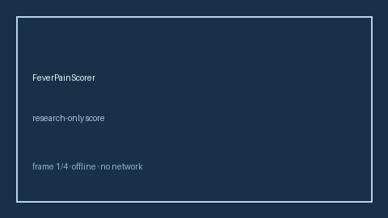

Research-only MDCalc / NICE FeverPAIN pharyngitis score. Stack: GPT-5.5 / Claude Sonnet 4.6 / Gemini 3.x / Kimi K2.
### BishopScoreScorer (Safety #221)

Research-only MDCalc / ACOG Bishop score for induction readiness. Stack: GPT-5.5 / Claude Sonnet 4.6 / Gemini 3.x / Kimi K2.

### ApgarScoreScorer (Safety #222)

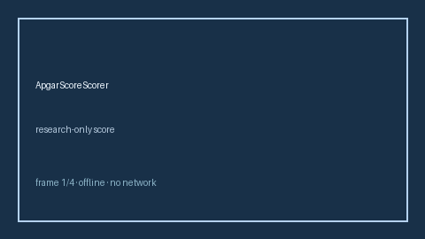

Research-only MDCalc / AAP Apgar newborn score. Stack: GPT-5.5 / Claude Sonnet 4.6 / Gemini 3.x / Kimi K2.

### PewsEarlyWarningScorer (Safety #223)

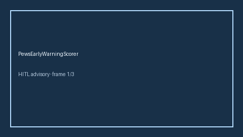

Research-only MDCalc / RCN PEWS pediatric early warning score. Stack: GPT-5.5 / Claude Sonnet 4.6 / Gemini 3.x / Kimi K2.

### DukeEndocarditisCriteriaScorer (Safety #224)

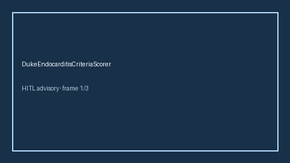

Research-only MDCalc / AHA modified Duke endocarditis criteria. Stack: GPT-5.5 / Claude Sonnet 4.6 / Gemini 3.x / Kimi K2.

### LamsStrokeScaleScorer (Safety #231)

Research-only advisory scorer. Gap vs MDCalc / AHA LAMS large-vessel occlusion screen. Stack: GPT-5.5 / Claude Sonnet 4.6 / Gemini 3.x / Kimi K2. See `docs/guides/LAMSSTROKESCALESCORER_GUIDE.md`.

### RaceStrokeScaleScorer (Safety #230)

Research-only advisory scorer. Gap vs MDCalc / AHA RACE stroke scale. Stack: GPT-5.5 / Claude Sonnet 4.6 / Gemini 3.x / Kimi K2. See `docs/guides/RACESTROKESCALESCORER_GUIDE.md`.

### RemsPeSeverityScorer

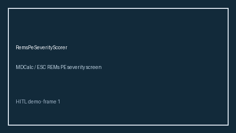

Research-only MDCalc / ESC REMs PE severity screen advisory scorer (Safety #236). Stack: GPT-5.5 / Claude Sonnet 4.6 / Gemini 3.x / Kimi K2. See `docs/guides/REMSPESEVERITYSCORER_GUIDE.md`.

### Fib4LiverScorer

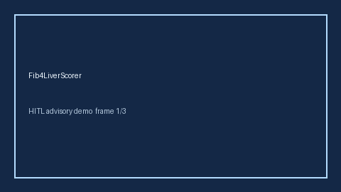

Research-only advisory scorer. Gap vs MDCalc / AASLD FIB-4 liver fibrosis screen. Optional narrative via GPT-5.5 / Claude Sonnet 4.6 / Gemini 3.x / Kimi K2.

### BisapPancreatitisScorer

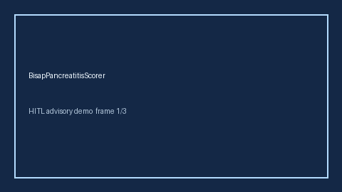

Research-only advisory scorer. Gap vs MDCalc / ACG BISAP pancreatitis severity screen. Optional narrative via GPT-5.5 / Claude Sonnet 4.6 / Gemini 3.x / Kimi K2.

### Gad7AnxietyScorer

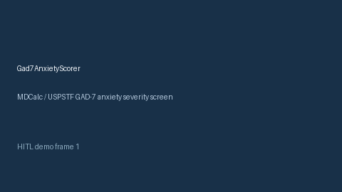

Research-only advisory scorer. Gap vs MDCalc / USPSTF GAD-7 anxiety severity screen. Optional narrative via GPT-5.5 / Claude Sonnet 4.6 / Gemini 3.x / Kimi K2.

### BradenPressureScorer

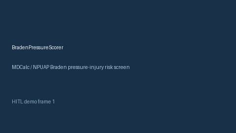

Research-only advisory scorer. Gap vs MDCalc / NPUAP Braden pressure-injury risk screen. Optional narrative via GPT-5.5 / Claude Sonnet 4.6 / Gemini 3.x / Kimi K2.

### RassSedationScorer

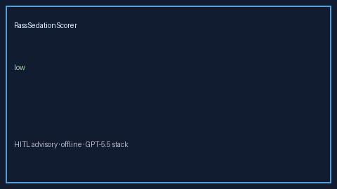

Research-only Safety #247. Gap vs MDCalc / SCCM Richmond Agitation-Sedation Scale (RASS) screen. See `docs/guides/RASSSEDATIONSCORER_GUIDE.md`.

### EcogPerformanceScorer

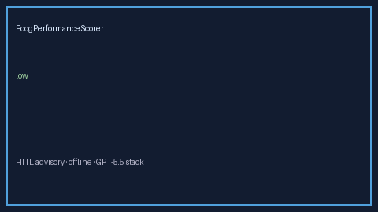

Research-only Safety #248. Gap vs MDCalc / ECOG/WHO performance status screen. See `docs/guides/ECOGPERFORMANCESCORER_GUIDE.md`.

### BarthelAdlScorer

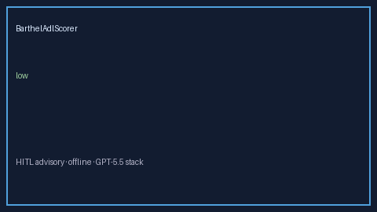

Research-only Safety #249. Gap vs MDCalc / Barthel Index ADL independence screen. See `docs/guides/BARTHELADLSCORER_GUIDE.md`.

### FourAtDeliriumScorer

Research-only advisory score (Safety #250). Gap vs MDCalc / 4AT rapid delirium screen. See `docs/guides/FOURATDELIRIUMSCORER_GUIDE.md`.

### WaterlooPressureScorer

Research-only Safety #246. Gap vs MDCalc / Waterloo pressure-injury risk screen. See `docs/guides/WATERLOOPRESSURESCORER_GUIDE.md`.

### CamIcuDeliriumScorer

Research-only Safety #245. Gap vs MDCalc / SCCM CAM-ICU delirium screen. See `docs/guides/CAMICUDELIRIUMSCORER_GUIDE.md`.

### AscvdRiskScorer

Research-only Safety #244. Gap vs MDCalc / ACC-AHA ASCVD 10-year risk screen. See `docs/guides/ASCVDRISKSCORER_GUIDE.md`.

### MorseFallScorer

Research-only advisory scorer. Gap vs MDCalc / AHRQ Morse Fall Scale screen. Optional narrative via GPT-5.5 / Claude Sonnet 4.6 / Gemini 3.x / Kimi K2.

### Phq9DepressionScorer

Research-only advisory scorer. Gap vs MDCalc / USPSTF PHQ-9 depression severity screen. Optional narrative via GPT-5.5 / Claude Sonnet 4.6 / Gemini 3.x / Kimi K2.

### SmartCopPneumoniaScorer

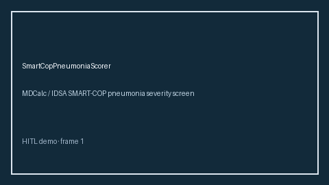

Research-only MDCalc / IDSA SMART-COP pneumonia severity screen advisory scorer (Safety #237). Stack: GPT-5.5 / Claude Sonnet 4.6 / Gemini 3.x / Kimi K2. See `docs/guides/SMARTCOPPNEUMONIASCORER_GUIDE.md`.

### ShockIndexScorer

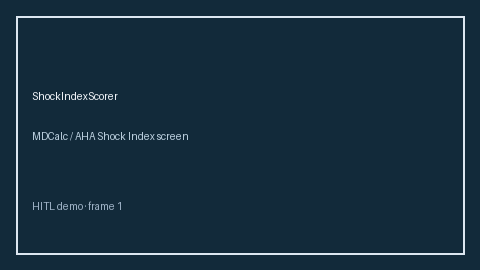

Research-only MDCalc / AHA Shock Index screen advisory scorer (Safety #235). Stack: GPT-5.5 / Claude Sonnet 4.6 / Gemini 3.x / Kimi K2. See `docs/guides/SHOCKINDEXSCORER_GUIDE.md`.

### CincinnatiPrehospitalStrokeScorer

Research-only MDCalc / AHA Cincinnati Prehospital Stroke Scale screen advisory scorer (Safety #234). Stack: GPT-5.5 / Claude Sonnet 4.6 / Gemini 3.x / Kimi K2. See `docs/guides/CINCINNATIPREHOSPITALSTROKESCORER_GUIDE.md`.

### EpworthSleepinessScorer

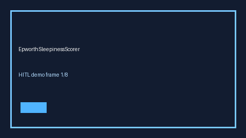

Research-only MDCalc / AASM Epworth Sleepiness Scale screen advisory scorer (Safety #233). Stack: GPT-5.5 / Claude Sonnet 4.6 / Gemini 3.x / Kimi K2. See `docs/guides/EPWORTHSLEEPINESSSCORER_GUIDE.md`.

### MallampatiAirwayScorer

Research-only MDCalc / ASA Mallampati airway class screen advisory scorer (Safety #232). Stack: GPT-5.5 / Claude Sonnet 4.6 / Gemini 3.x / Kimi K2. See `docs/guides/MALLAMPATIAIRWAYSCORER_GUIDE.md`.

### StopBangOsaScorer (Safety #229)

Research-only advisory scorer. Gap vs MDCalc / ASA STOP-BANG OSA screen. Stack: GPT-5.5 / Claude Sonnet 4.6 / Gemini 3.x / Kimi K2. See `docs/guides/STOPBANGOSASCORER_GUIDE.md`.

### MaddreyDiscriminantScorer (Safety #228)

Research-only MDCalc Maddrey discriminant function for alcoholic hepatitis. Stack: GPT-5.5 / Claude Sonnet 4.6 / Gemini 3.x / Kimi K2.

### PrismIiiPediatricScorer (Safety #227)

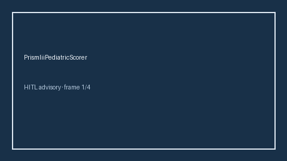

Research-only MDCalc / PICU PRISM III pediatric ICU score. Stack: GPT-5.5 / Claude Sonnet 4.6 / Gemini 3.x / Kimi K2.

### PhoenixSepsisCriteriaScorer (Safety #226)

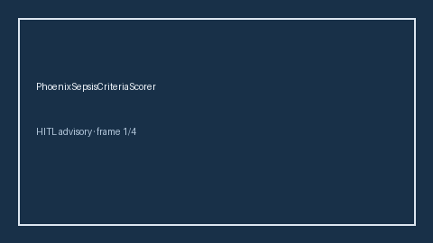

Research-only MDCalc / SCCM Phoenix sepsis criteria. Stack: GPT-5.5 / Claude Sonnet 4.6 / Gemini 3.x / Kimi K2.

### SirsCriteriaScorer (Safety #225)

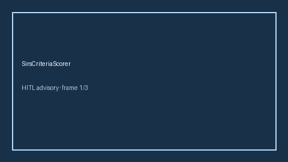

Research-only MDCalc / SCCM SIRS criteria screen. Stack: GPT-5.5 / Claude Sonnet 4.6 / Gemini 3.x / Kimi K2.

## Entry moved from above the README safety table

<!-- moved verbatim; image paths prefixed with ../ -->

- **OpioidSedationStackPanel** (#140): opioid + benzo + gabapentinoid aggregate sedation stacks — see `docs/guides/OPIOID_SEDATION_STACK_PANEL_GUIDE.md`

## Entries moved from the README Contributing section

<!-- moved verbatim; image paths prefixed with ../ -->

### KarnofskyPerformanceScorer

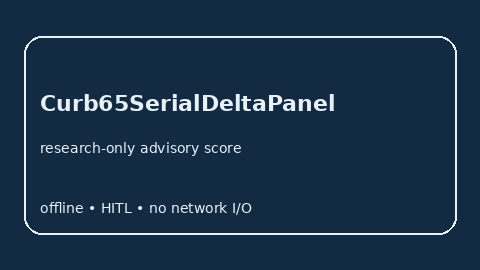
### Curb65SerialDeltaPanel

Research-only advisory score. Gap vs MDCalc / CURB-65 serial delta-trend panel. See `docs/guides/CURB65SERIALDELTAPANEL_GUIDE.md`.
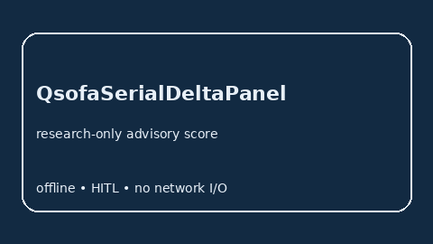

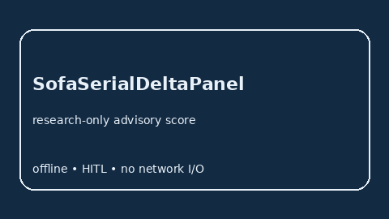

### MewsSerialDeltaPanel

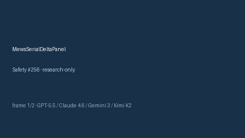

Research-only advisory score (Safety #256). Gap vs MDCalc / MEWS serial delta-trend panel. See `docs/guides/MEWSSERIALDELTAPANEL_GUIDE.md`.

### ForresterClassScorer

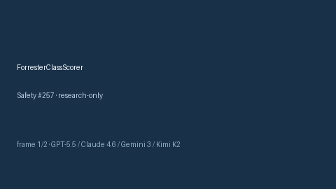

Research-only advisory score (Safety #257). Gap vs MDCalc / Killip-Forrester hemodynamic class screen. See `docs/guides/FORRESTERCLASSSCORER_GUIDE.md`.

### ApacheSerialDeltaPanel

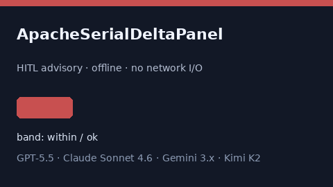

Research-only advisory score (Safety #259). Gap vs MDCalc / APACHE serial delta-trend panel. See `docs/guides/APACHESERIALDELTAPANEL_GUIDE.md`.

### ImproveVteScorer

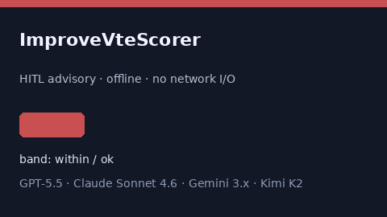

Research-only advisory score (Safety #260). Gap vs MDCalc / IMPROVE VTE risk screen. See `docs/guides/IMPROVEVTESCORER_GUIDE.md`.

### HeartSerialDeltaPanel

Research-only `HeartSerialDeltaPanel` (Safety #262). Gap vs MDCalc / HEART serial delta-trend panel. Stack: GPT-5.5 / Claude Sonnet 4.6 / Gemini 3.x / Kimi K2.

### WellsPeSerialDeltaPanel

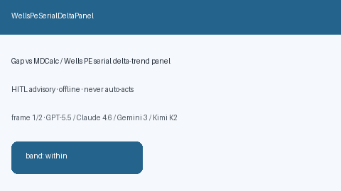

Research-only `WellsPeSerialDeltaPanel` (Safety #263). Gap vs MDCalc / Wells PE serial delta-trend panel. Stack: GPT-5.5 / Claude Sonnet 4.6 / Gemini 3.x / Kimi K2.

### WellsDvtSerialDeltaPanel

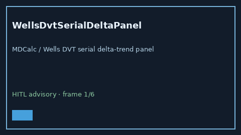

Research-only `WellsDvtSerialDeltaPanel` (Safety #265). Gap vs MDCalc / Wells DVT serial delta-trend panel. Stack: GPT-5.5 / Claude Sonnet 4.6 / Gemini 3.x / Kimi K2.

### GenevaPeSerialDeltaPanel

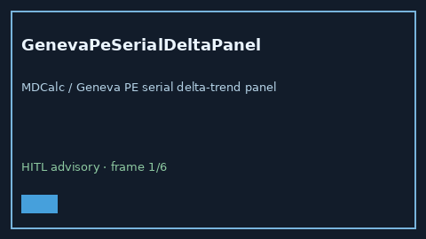

Research-only `GenevaPeSerialDeltaPanel` (Safety #266). Gap vs MDCalc / Geneva PE serial delta-trend panel. Stack: GPT-5.5 / Claude Sonnet 4.6 / Gemini 3.x / Kimi K2.

### PercSerialDeltaPanel

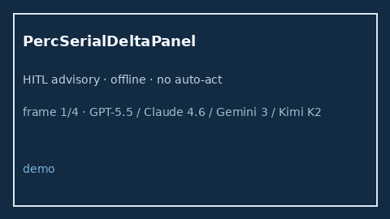

Research-only `PercSerialDeltaPanel` (Safety #268). Gap vs MDCalc / PERC serial delta-trend panel. Stack: GPT-5.5 / Claude Sonnet 4.6 / Gemini 3.x / Kimi K2.

### KillipSerialDeltaPanel

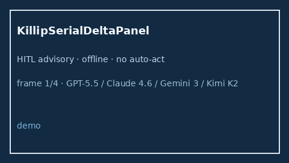

Research-only `KillipSerialDeltaPanel` (Safety #269). Gap vs MDCalc / Killip serial delta-trend panel. Stack: GPT-5.5 / Claude Sonnet 4.6 / Gemini 3.x / Kimi K2.

### CentorSerialDeltaPanel

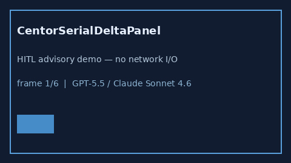

Research-only Safety #271. Gap vs MDCalc / Centor serial delta-trend panel. See `docs/guides/CENTORSERIALDELTAPANEL_GUIDE.md`.

### ChildPughSerialDeltaPanel

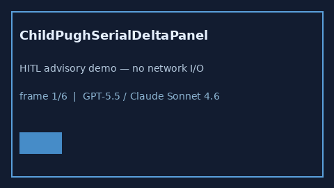

Research-only Safety #272. Gap vs MDCalc / Child-Pugh serial delta-trend panel. See `docs/guides/CHILDPUGHSERIALDELTAPANEL_GUIDE.md`.

### MeldNaSerialDeltaPanel

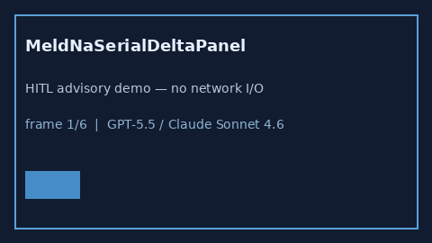

Research-only Safety #273. Gap vs MDCalc / MELD-Na serial delta-trend panel. See `docs/guides/MELDNASERIALDELTAPANEL_GUIDE.md`.

### Cha2ds2VascSerialDeltaPanel

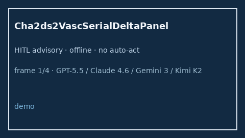

Research-only `Cha2ds2VascSerialDeltaPanel` (Safety #270). Gap vs MDCalc / CHA2DS2-VASc serial delta-trend panel. Stack: GPT-5.5 / Claude Sonnet 4.6 / Gemini 3.x / Kimi K2.

### TimiSerialDeltaPanel

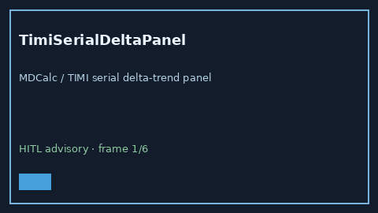

Research-only `TimiSerialDeltaPanel` (Safety #267). Gap vs MDCalc / TIMI serial delta-trend panel. Stack: GPT-5.5 / Claude Sonnet 4.6 / Gemini 3.x / Kimi K2.

### PsiSerialDeltaPanel

Research-only `PsiSerialDeltaPanel` (Safety #264). Gap vs MDCalc / PSI/PORT serial delta-trend panel. Stack: GPT-5.5 / Claude Sonnet 4.6 / Gemini 3.x / Kimi K2.

### AbcIchScorer

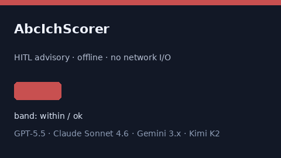

Research-only advisory score (Safety #261). Gap vs MDCalc / ABC ICH volume/severity screen. See `docs/guides/ABCICHSCORER_GUIDE.md`.

### AspectsStrokeScorer

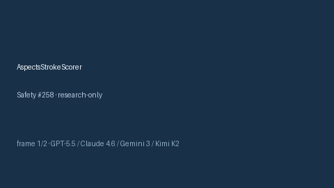

Research-only advisory score (Safety #258). Gap vs MDCalc / ASPECTS early ischemic change screen. See `docs/guides/ASPECTSSTROKESCORER_GUIDE.md`.

### SofaSerialDeltaPanel

### SofaSerialDeltaPanel

### SofaSerialDeltaPanel

### SofaSerialDeltaPanel

Research-only advisory score. Gap vs MDCalc / SOFA serial delta-trend panel. See `docs/guides/SOFASERIALDELTAPANEL_GUIDE.md`.
### QsofaSerialDeltaPanel

### QsofaSerialDeltaPanel

Research-only advisory score. Gap vs MDCalc / qSOFA serial delta-trend panel. See `docs/guides/QSOFASERIALDELTAPANEL_GUIDE.md`.
### News2SerialDeltaPanel

### AlvaradoSerialDeltaPanel

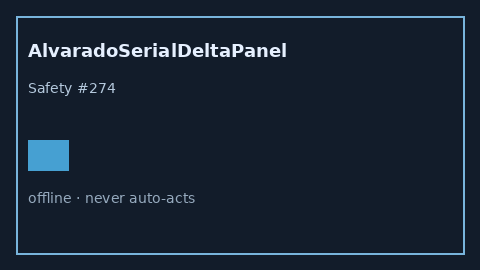

Research-only Safety #274. Gap vs MDCalc / Alvarado serial delta-trend panel. Distinct from `AlvaradoAppendicitisScorer` / `CentorSerialDeltaPanel`. Stack: GPT-5.5 / Claude Sonnet 4.6 / Gemini 3.x / Kimi K2.

### NihssSerialDeltaPanel

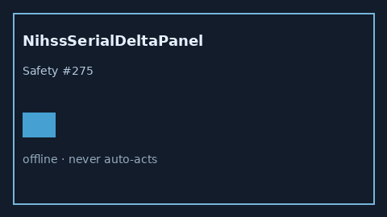

Research-only Safety #275. Gap vs MDCalc / NIHSS serial delta-trend panel. Distinct from `NihssStrokeScorer` / `GcsNeurologicStatusScorer`. Stack: GPT-5.5 / Claude Sonnet 4.6 / Gemini 3.x / Kimi K2.

### GcsSerialDeltaPanel

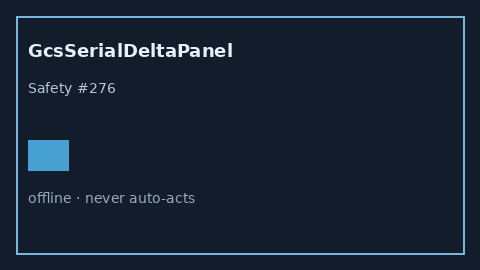

Research-only Safety #276. Gap vs MDCalc / GCS serial delta-trend panel. Distinct from `GcsNeurologicStatusScorer` / `NihssSerialDeltaPanel`. Stack: GPT-5.5 / Claude Sonnet 4.6 / Gemini 3.x / Kimi K2.

### RansonSerialDeltaPanel

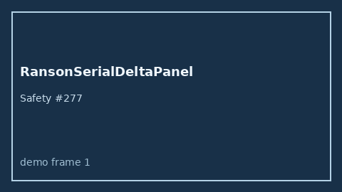

Research-only Safety #277. Gap vs MDCalc / Ranson serial delta-trend panel. Distinct from `RansonPancreatitisScorer` / `BisapPancreatitisScorer`. Stack: GPT-5.5 / Claude Sonnet 4.6 / Gemini 3.x / Kimi K2.

### OttawaAnkleSerialDeltaPanel

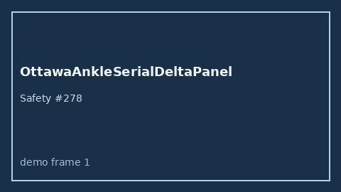

Research-only Safety #278. Gap vs MDCalc / Ottawa Ankle serial delta-trend panel. Distinct from `OttawaAnkleRuleScorer` / `OttawaKneeRuleScorer`. Stack: GPT-5.5 / Claude Sonnet 4.6 / Gemini 3.x / Kimi K2.

### Abcd2SerialDeltaPanel

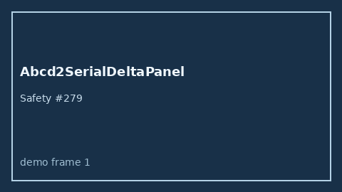

Research-only Safety #279. Gap vs MDCalc / ABCD2 serial delta-trend panel. Distinct from `Abcd2TiaRiskScorer` / `NihssSerialDeltaPanel`. Stack: GPT-5.5 / Claude Sonnet 4.6 / Gemini 3.x / Kimi K2.

### OttawaSahSerialDeltaPanel

Research-only Safety #286. Gap vs MDCalc / Ottawa SAH Rule serial delta-trend panel. Distinct from `OttawaSahRuleScorer` / `HuntHessSahScorer`. Stack: GPT-5.5 / Claude Sonnet 4.6 / Gemini 3.x / Kimi K2. See `docs/guides/OTTAWASAHSERIALDELTAPANEL_GUIDE.md`.

### PesiSerialDeltaPanel

Research-only Safety #287. Gap vs MDCalc / PESI PE severity serial delta-trend panel. Distinct from `PesiPeSeverityScorer` / `WellsPeSerialDeltaPanel`. Stack: GPT-5.5 / Claude Sonnet 4.6 / Gemini 3.x / Kimi K2. See `docs/guides/PESISERIALDELTAPANEL_GUIDE.md`.

### GlasgowBlatchfordSerialDeltaPanel

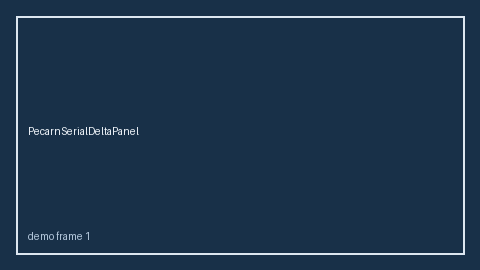

Research-only Safety #288. Gap vs MDCalc / Glasgow-Blatchford GI bleed serial delta-trend panel. Distinct from `GlasgowBlatchfordScorer` / `RockallGiBleedScorer`. Stack: GPT-5.5 / Claude Sonnet 4.6 / Gemini 3.x / Kimi K2. See `docs/guides/GLASGOWBLATCHFORDSERIALDELTAPANEL_GUIDE.md`.

### FourScoreSerialDeltaPanel

Research-only Safety #289. Gap vs MDCalc / FOUR Score serial delta-trend panel. Distinct from `FourScoreScorer` / `GcsSerialDeltaPanel`. Stack: GPT-5.5 / Claude Sonnet 4.6 / Gemini 3.x / Kimi K2. See `docs/guides/FOURSCORESERIALDELTAPANEL_GUIDE.md`.

### HuntHessSerialDeltaPanel

Research-only Safety #290. Gap vs MDCalc / Hunt-Hess SAH serial delta-trend panel. Distinct from `HuntHessSahScorer` / `OttawaSahSerialDeltaPanel`. Stack: GPT-5.5 / Claude Sonnet 4.6 / Gemini 3.x / Kimi K2. See `docs/guides/HUNTHESSSERIALDELTAPANEL_GUIDE.md`.

### WfnsSerialDeltaPanel

Research-only Safety #291. Gap vs MDCalc / WFNS SAH serial delta-trend panel. Distinct from `WfnsSahScorer` / `HuntHessSerialDeltaPanel`. Stack: GPT-5.5 / Claude Sonnet 4.6 / Gemini 3.x / Kimi K2. See `docs/guides/WFNSSERIALDELTAPANEL_GUIDE.md`.

### RassSerialDeltaPanel

Research-only Safety #295. Gap vs MDCalc / RASS sedation serial delta-trend panel. Distinct from `RassSedationScorer` / `CamIcuDeliriumScorer`. Stack: GPT-5.5 / Claude Sonnet 4.6 / Gemini 3.x / Kimi K2. See `docs/guides/RASSSERIALDELTAPANEL_GUIDE.md`.

### KarnofskySerialDeltaPanel

Research-only Safety #296. Gap vs MDCalc / Karnofsky performance serial delta-trend panel. Distinct from `KarnofskyPerformanceScorer` / `EcogSerialDeltaPanel`. Stack: GPT-5.5 / Claude Sonnet 4.6 / Gemini 3.x / Kimi K2. See `docs/guides/KARNOFSKYSERIALDELTAPANEL_GUIDE.md`.

### BradenSerialDeltaPanel

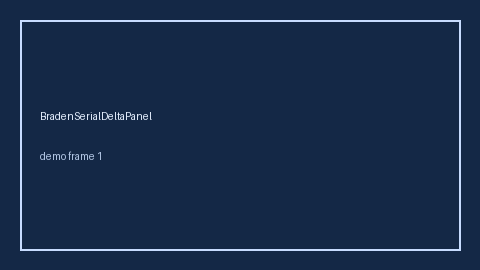

Research-only Safety #298. Gap vs MDCalc / Braden pressure-injury serial delta-trend panel. Distinct from `BradenPressureScorer` / `MorseFallScorer`. Stack: GPT-5.5 / Claude Sonnet 4.6 / Gemini 3.x / Kimi K2. See `docs/guides/BRADENSERIALDELTAPANEL_GUIDE.md`.

### MorseFallSerialDeltaPanel

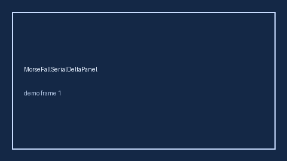

Research-only Safety #299. Gap vs MDCalc / Morse Fall Scale serial delta-trend panel. Distinct from `MorseFallScorer` / `BradenPressureScorer`. Stack: GPT-5.5 / Claude Sonnet 4.6 / Gemini 3.x / Kimi K2. See `docs/guides/MORSEFALLSERIALDELTAPANEL_GUIDE.md`.

### WaterlowSerialDeltaPanel

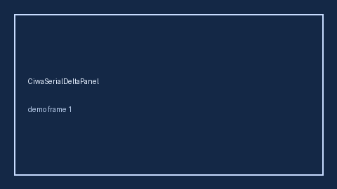

Research-only Safety #301. Gap vs MDCalc / Waterlow pressure-ulcer serial delta-trend panel. Distinct from `BradenSerialDeltaPanel` / `BradenPressureScorer`. Stack: GPT-5.5 / Claude Sonnet 4.6 / Gemini 3.x / Kimi K2. See `docs/guides/WATERLOWSERIALDELTAPANEL_GUIDE.md`.

### BarthelSerialDeltaPanel

Research-only Safety #302. Gap vs MDCalc / Barthel ADL serial delta-trend panel. Distinct from `BarthelAdlScorer` / `KarnofskySerialDeltaPanel`. Stack: GPT-5.5 / Claude Sonnet 4.6 / Gemini 3.x / Kimi K2. See `docs/guides/BARTHELSERIALDELTAPANEL_GUIDE.md`.

### MocaSerialDeltaPanel
- `KatzSerialDeltaPanel` (Safety #306): MDCalc / Katz ADL serial delta-trend panel. Distinct from `BarthelSerialDeltaPanel` / `KarnofskySerialDeltaPanel`. Stack: GPT-5.5 / Claude Sonnet 4.6 / Gemini 3.x / Kimi K2.

- `Gad7SerialDeltaPanel` (Safety #305): MDCalc / GAD-7 anxiety serial delta-trend panel. Distinct from `Gad7AnxietyScorer` / `Phq9DepressionScorer`. Stack: GPT-5.5 / Claude Sonnet 4.6 / Gemini 3.x / Kimi K2.

- `Phq9SerialDeltaPanel` (Safety #304): MDCalc / PHQ-9 depression serial delta-trend panel. Distinct from `Phq9DepressionScorer` / `Gad7AnxietyScorer`. Stack: GPT-5.5 / Claude Sonnet 4.6 / Gemini 3.x / Kimi K2.

Research-only Safety #303. Gap vs MDCalc / MoCA cognition serial delta-trend panel. Distinct from `FourScoreSerialDeltaPanel` / `GcsSerialDeltaPanel`. Stack: GPT-5.5 / Claude Sonnet 4.6 / Gemini 3.x / Kimi K2. See `docs/guides/MOCASERIALDELTAPANEL_GUIDE.md`.

### CiwaSerialDeltaPanel

Research-only Safety #300. Gap vs MDCalc / CIWA-Ar withdrawal serial delta-trend panel. Distinct from `CiwaArWithdrawalScorer` / `RassSerialDeltaPanel`. Stack: GPT-5.5 / Claude Sonnet 4.6 / Gemini 3.x / Kimi K2. See `docs/guides/CIWASERIALDELTAPANEL_GUIDE.md`.

### CamIcuSerialDeltaPanel

Research-only Safety #297. Gap vs MDCalc / CAM-ICU delirium serial delta-trend panel. Distinct from `CamIcuDeliriumScorer` / `FourAtSerialDeltaPanel`. Stack: GPT-5.5 / Claude Sonnet 4.6 / Gemini 3.x / Kimi K2. See `docs/guides/CAMICUSERIALDELTAPANEL_GUIDE.md`.

### EcogSerialDeltaPanel

Research-only Safety #294. Gap vs MDCalc / ECOG performance serial delta-trend panel. Distinct from `EcogPerformanceScorer` / `KarnofskyPerformanceScorer`. Stack: GPT-5.5 / Claude Sonnet 4.6 / Gemini 3.x / Kimi K2. See `docs/guides/ECOGSERIALDELTAPANEL_GUIDE.md`.

### FourAtSerialDeltaPanel

Research-only Safety #293. Gap vs MDCalc / 4AT delirium serial delta-trend panel. Distinct from `FourAtDeliriumScorer` / `FourScoreSerialDeltaPanel`. Stack: GPT-5.5 / Claude Sonnet 4.6 / Gemini 3.x / Kimi K2. See `docs/guides/FOURATSERIALDELTAPANEL_GUIDE.md`.

### ForresterSerialDeltaPanel

Research-only Safety #292. Gap vs MDCalc / Forrester hemodynamic serial delta-trend panel. Distinct from `ForresterClassScorer` / `KillipSerialDeltaPanel`. Stack: GPT-5.5 / Claude Sonnet 4.6 / Gemini 3.x / Kimi K2. See `docs/guides/FORRESTERSERIALDELTAPANEL_GUIDE.md`.

## Entries moved from after the README disclaimer

<!-- moved verbatim; image paths prefixed with ../ -->

### CanadianCtHeadSerialDeltaPanel

Research-only Safety #283. Gap vs MDCalc / Canadian CT Head Rule serial delta-trend panel. Distinct from `CanadianCtHeadScorer` / `PecarnSerialDeltaPanel`. Stack: GPT-5.5 / Claude Sonnet 4.6 / Gemini 3.x / Kimi K2. See `docs/guides/CANADIANCTHEADSERIALDELTAPANEL_GUIDE.md`.

### PecarnSerialDeltaPanel

Research-only Safety #284. Gap vs MDCalc / PECARN pediatric head trauma serial delta-trend panel. Distinct from `PecarnHeadTraumaScorer` / `CanadianCtHeadSerialDeltaPanel`. Stack: GPT-5.5 / Claude Sonnet 4.6 / Gemini 3.x / Kimi K2. See `docs/guides/PECARNSERIALDELTAPANEL_GUIDE.md`.

### NexusCspineSerialDeltaPanel

Research-only Safety #285. Gap vs MDCalc / NEXUS C-spine serial delta-trend panel. Distinct from `NexusCspineScorer` / `CanadianCspineRuleScorer`. Stack: GPT-5.5 / Claude Sonnet 4.6 / Gemini 3.x / Kimi K2. See `docs/guides/NEXUSCSPINESERIALDELTAPANEL_GUIDE.md`.

### GraceSerialDeltaPanel

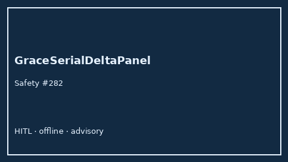

Research-only Safety #282. Gap vs MDCalc / GRACE ACS serial delta-trend panel. Distinct from `GraceAcsScorer` / `HeartSerialDeltaPanel`.

### HasBledSerialDeltaPanel

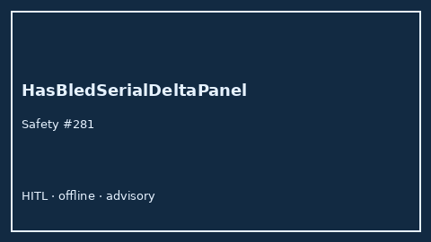

Research-only Safety #281. Gap vs MDCalc / HAS-BLED serial delta-trend panel. Distinct from `HasBledBleedRiskScorer` / `Cha2ds2VascSerialDeltaPanel`.

### PsiPortSerialDeltaPanel

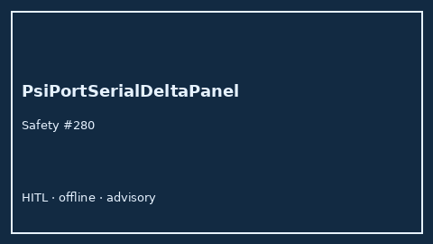

Research-only Safety #280. Gap vs MDCalc / PSI/PORT serial delta-trend panel. Distinct from `PsiPortPneumoniaScorer` / `Curb65SerialDeltaPanel`.

## Entries added after the move

<!-- Append new panel and scorer entries below this line. -->
