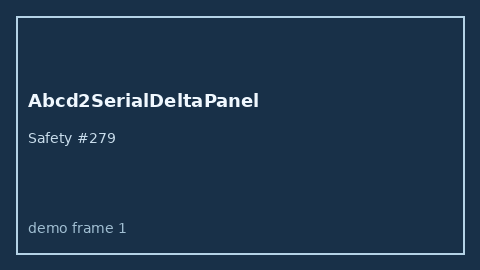

# Abcd2SerialDeltaPanel Guide



Research-only Safety #279.
Gap vs MDCalc / ABCD2 serial delta-trend panel. Distinct from `Abcd2TiaRiskScorer` / `NihssSerialDeltaPanel`.

Stack: **GPT-5.5 / Claude Sonnet 4.6 / Gemini 3.x / Kimi K2**.

## Usage

```python
from medagent.safety.abcd2_serial_delta_panel import Abcd2SerialDeltaFactors, Abcd2SerialDeltaPanel

findings = Abcd2SerialDeltaPanel().check(Abcd2SerialDeltaFactors())
print(findings[0].band, findings[0].rationale)
```

## Safety

RESEARCH USE ONLY. Advisory. Never modifies medications. No network I/O.
