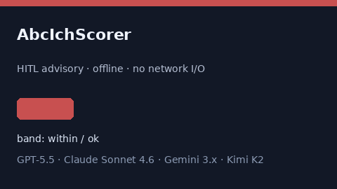

# AbcIchScorer Guide



Research-only advisory score (Safety #261).
Gap vs MDCalc / ABC ICH volume/severity screen. Distinct from `IchScoreScorer` / `HuntHessSahScorer`.

Optional narrative via **GPT-5.5 / Claude Sonnet 4.6 / Gemini 3.x / Kimi K2**.

## Usage

```python
from medagent.safety.abc_ich_scorer import (
    AbcIchFactors,
    AbcIchScorer,
)

findings = AbcIchScorer().check(AbcIchFactors())
assert findings[0].rationale
print(findings[0].band)
```

## Safety

RESEARCH USE ONLY. Advisory. Never modifies medications. No network I/O.
