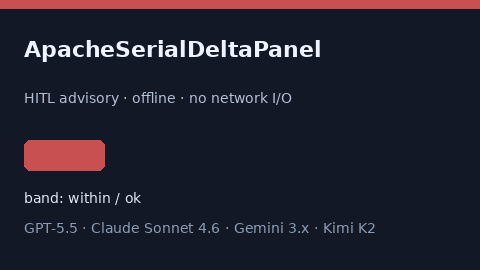

# ApacheSerialDeltaPanel Guide



Research-only advisory score (Safety #259).
Gap vs MDCalc / APACHE serial delta-trend panel. Distinct from `ApacheIiLiteScorer` / `SofaSerialDeltaPanel`.

Optional narrative via **GPT-5.5 / Claude Sonnet 4.6 / Gemini 3.x / Kimi K2**.

## Usage

```python
from medagent.safety.apache_serial_delta_panel import (
    ApacheSerialDeltaFactors,
    ApacheSerialDeltaPanel,
)

findings = ApacheSerialDeltaPanel().check(ApacheSerialDeltaFactors())
assert findings[0].rationale
print(findings[0].band)
```

## Safety

RESEARCH USE ONLY. Advisory. Never modifies medications. No network I/O.
