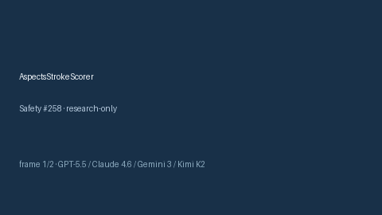

# AspectsStrokeScorer Guide



Research-only advisory score (Safety #258).
Gap vs MDCalc / ASPECTS early ischemic change screen. Distinct from `NihssStrokeScorer` / `CanadianCtHeadScorer`.

Optional narrative via **GPT-5.5 / Claude Sonnet 4.6 / Gemini 3.x / Kimi K2**.

## Usage

```python
from medagent.safety.aspects_stroke_scorer import (
    AspectsStrokeFactors,
    AspectsStrokeScorer,
)

findings = AspectsStrokeScorer().check(AspectsStrokeFactors())
assert findings[0].rationale
print(findings[0].band)
```

## Safety

RESEARCH USE ONLY. Advisory. Never modifies medications. No network I/O.
