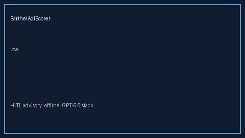

# BarthelAdlScorer Guide



Research-only advisory scorer. Gap vs MDCalc / Barthel Index ADL independence screen.
Distinct from `MorseFallScorer` / `BradenPressureScorer`. Safety #249.

Narrative polish via **GPT-6 Astra / Claude Opus 5.5 / Gemini 4 Argon / Kimi K3.1 Pro**.

## Usage

```python
from medagent.safety.barthel_adl_scorer import BarthelAdlFactors, BarthelAdlScorer

findings = BarthelAdlScorer().check(BarthelAdlFactors())
print(findings[0].band, findings[0].rationale)
```

## Safety

RESEARCH USE ONLY. Never modifies medications. No network I/O.
