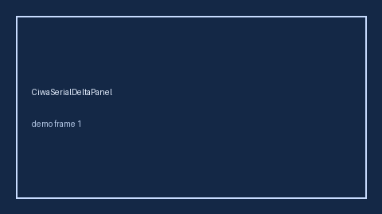

# BarthelSerialDeltaPanel Guide



Research-only Safety #302 serial delta panel.
Offline helper.
Gap vs MDCalc / Barthel ADL serial delta-trend panel. Distinct from `BarthelAdlScorer` / `KarnofskySerialDeltaPanel`.

Stack: **GPT-6 Astra / Claude Opus 5.5 / Gemini 4 Argon / Kimi K3.1 Pro**.

## Usage

```python
from medagent.safety.barthel_serial_delta_panel import (
    BarthelSerialDeltaFactors,
    BarthelSerialDeltaPanel,
)

findings = BarthelSerialDeltaPanel().check(BarthelSerialDeltaFactors())
print(findings[0].band, findings[0].rationale)
```

## Safety

Advisory only. No network I/O. Never auto-acts. Humans decide.
