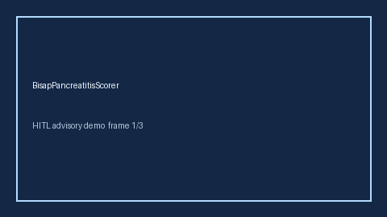

# BisapPancreatitisScorer Guide



Research-only advisory scorer. Gap vs MDCalc / ACG BISAP pancreatitis severity screen. Distinct from `RansonPancreatitisScorer` / `MaddreyDiscriminantScorer`.

Optional narrative via **GPT-5.5 / Claude Sonnet 4.6 / Gemini 3.x / Kimi K2**.

## Usage

```python
from medagent.safety.bisap_pancreatitis_scorer import (
    BisapPancreatitisFactors,
    BisapPancreatitisScorer,
)

findings = BisapPancreatitisScorer().check(BisapPancreatitisFactors())
print(findings[0].band)
```

## Safety

RESEARCH USE ONLY. Never modifies medications. See `SAFETY.md` #239.
