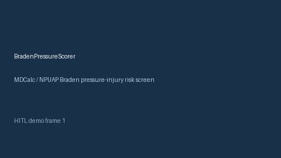

# BradenPressureScorer Guide



Research-only advisory scorer. Gap vs MDCalc / NPUAP Braden pressure-injury risk screen. Distinct from `News2EarlyWarningScorer` / `SofaOrganFailureScorer`.

Optional narrative via **GPT-5.5 / Claude Sonnet 4.6 / Gemini 3.x / Kimi K2**.

## Usage

```python
from medagent.safety.braden_pressure_scorer import (
    BradenPressureFactors,
    BradenPressureScorer,
)

findings = BradenPressureScorer().check(BradenPressureFactors())
print(findings[0].band)
```

## Safety

RESEARCH USE ONLY. Never modifies medications. See `SAFETY.md` #242.
