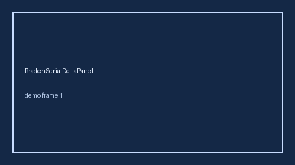

# BradenSerialDeltaPanel Guide



Research-only Safety #298 serial delta panel.
Offline helper.
Gap vs MDCalc / Braden pressure-injury serial delta-trend panel. Distinct from `BradenPressureScorer` / `MorseFallScorer`.

Stack: **GPT-5.5 / Claude Sonnet 4.6 / Gemini 3.x / Kimi K2**.

## Usage

```python
from medagent.safety.braden_serial_delta_panel import (
    BradenSerialDeltaFactors,
    BradenSerialDeltaPanel,
)

findings = BradenSerialDeltaPanel().check(BradenSerialDeltaFactors())
print(findings[0].band, findings[0].rationale)
```

## Safety

Advisory only. No network I/O. Never auto-acts. Humans decide.
