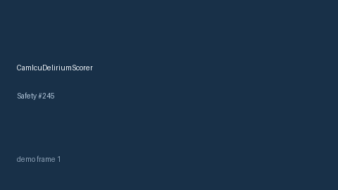

# CamIcuDeliriumScorer Guide



Research-only advisory scorer. Gap vs MDCalc / SCCM CAM-ICU delirium screen.
Distinct from `GcsNeurologicStatusScorer` / `CiwaArWithdrawalScorer`. Safety #245.

Narrative polish via **GPT-6 Astra / Claude Opus 5.5 / Gemini 4 Argon / Kimi K3.1 Pro**.

## Usage

```python
from medagent.safety.cam_icu_delirium_scorer import CamIcuDeliriumFactors, CamIcuDeliriumScorer

findings = CamIcuDeliriumScorer().check(CamIcuDeliriumFactors())
print(findings[0].band, findings[0].rationale)
```

## Safety

RESEARCH USE ONLY. Never modifies medications. No network I/O.
