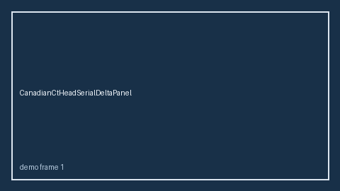

# CanadianCtHeadSerialDeltaPanel Guide



Research-only serial delta panel (Safety #283).
Gap vs MDCalc / Canadian CT Head Rule serial delta-trend panel. Distinct from `CanadianCtHeadScorer` / `PecarnSerialDeltaPanel`.

Stack: **GPT-6 Astra / Claude Opus 5.5 / Gemini 4 Argon / Kimi K3.1 Pro**.

## Usage

```python
from medagent.safety.canadian_ct_head_serial_delta_panel import (
    CanadianCtHeadSerialDeltaFactors,
    CanadianCtHeadSerialDeltaPanel,
)

findings = CanadianCtHeadSerialDeltaPanel().check(CanadianCtHeadSerialDeltaFactors())
print(findings[0].band, findings[0].rationale)
```

## Safety

RESEARCH USE ONLY. Advisory. No network I/O. Never modifies medications.
