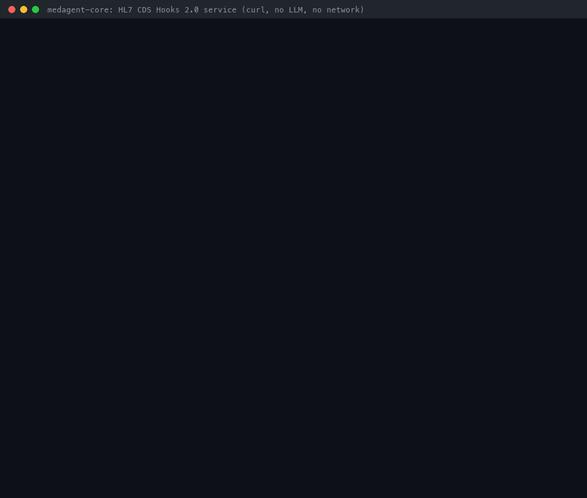
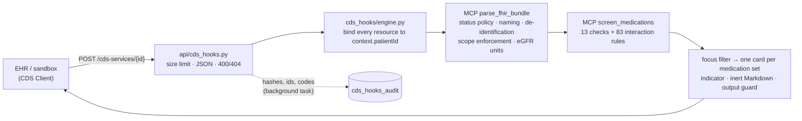

# CDS Hooks Guide

*medagent-core — an HL7 CDS Hooks 2.0 service for the deterministic medication-safety checks*



> **⚠️ RESEARCH USE ONLY — NOT FDA-cleared — NOT for clinical deployment.** Every card carries the
> mandatory disclaimer. Cards are advisory for review by a licensed clinician; they are never
> prescriptions or treatment orders, the service never changes an order, and the absence of a card
> is not evidence of safety. **The service does not verify CDS Hooks JWTs: run it only in research
> sandboxes, behind an authenticating gateway** ([Security](#security-and-authentication)).

`/cds-services` lets an EHR order workflow call medagent's existing deterministic, offline
medication-safety checks through [HL7 CDS Hooks 2.0](https://cds-hooks.hl7.org/2.0/). It is part of
the FastAPI app (`medagent`), makes no LLM or network calls, and reuses the MCP server's FHIR
normalisation (`parse_fhir_bundle`) and screening (`screen_medications`) instead of duplicating
them.

## Contents

- [Why this exists](#why-this-exists)
- [Services at a glance](#services-at-a-glance)
- [Quickstart](#quickstart)
- [Sample cards (real output)](#sample-cards-real-output)
- [From FHIR to cards](#from-fhir-to-cards)
- [Indicator mapping](#indicator-mapping)
- [Prefetch templates](#prefetch-templates)
- [Feedback](#feedback)
- [Audit trail](#audit-trail)
- [Errors](#errors)
- [CORS and the public CDS Hooks sandbox](#cors-and-the-public-cds-hooks-sandbox)
- [Security and authentication](#security-and-authentication)
- [Safety guarantees](#safety-guarantees)
- [Known limitations](#known-limitations)
- [Comparison](#comparison)
- [Configuration](#configuration)
- [Troubleshooting](#troubleshooting)
- [How this demo was recorded](#how-this-demo-was-recorded)

## Why this exists

[CDS Hooks](https://cds-hooks.hl7.org/2.0/) is the HL7 standard that EHRs use to call external
clinical decision support at workflow moments such as `order-select` (an order was just picked)
and `order-sign` (orders are about to be signed). EHR vendors such as Epic and Oracle Health
(Cerner) support it, and the public [CDS Hooks sandbox](https://sandbox.cds-hooks.org)
([source](https://github.com/cds-hooks/sandbox)) is a browser-based mock EHR for trying services.
Open implementations include that sandbox and the
[HAPI FHIR CDS Hooks module](https://github.com/hapifhir/hapi-fhir/tree/master/hapi-fhir-server-cds-hooks),
a Java framework for writing CDS services.

medagent already had a FHIR R4 parser and a registry of deterministic safety checks — 13
patient-context and medication-list checks plus 83 offline drug-interaction rules — exposed to
Claude, Cursor and VS Code over [MCP](MCP_SERVER_GUIDE.md). An EHR's order workflow had no way to
call them. **Gap closed:** an EHR (or the sandbox) can now send the draft orders and prefetched
patient data of an ordering session and get back CDS Hooks cards, from the same checks, with the
same de-identification, scope enforcement and output guard as the MCP tools.

## Services at a glance

| Service id | Hook | Screens | Cards for |
| --- | --- | --- | --- |
| `medagent-medication-safety` | `order-sign` | Every draft `MedicationRequest` in `context.draftOrders` (status `draft`, `active` or `on-hold`) against current medications, allergies, age and eGFR | Findings that involve at least one draft order |
| `medagent-medication-safety-select` | `order-select` | The orders in `context.selections`, the other unsigned drafts and current medications | Findings that involve at least one *selected* order |

Both advertise the same [prefetch templates](#prefetch-templates). Each finding comes from an
existing checker: allergy and inter-class cross-reactivity, Beers (65+), renal dosing (eGFR),
duplicate therapy, QT burden, anticholinergic burden, serotonergic combinations, boxed warnings,
ACEI/ARB/ARNI duplication, and every offline interaction rule (`list_safety_controls` over MCP
lists them). Pregnancy, lactation and hepatic dosing never run here: those statuses are not derived
from FHIR.

## Quickstart

Python 3.10+, no API keys, no network. You also need `curl` and `jq` (and `sqlite3` to inspect
the audit trail in step 6).

```bash
git clone https://github.com/Francis1998/medagent-core && cd medagent-core
pip install -e .                                   # or: uv pip install -e .
PII_HASH_SALT="$(python -c 'import secrets; print(secrets.token_hex(32))')" medagent --port 8000
```

In a second terminal, from the repository root. Every output below is real and unedited (see
[`cds_hooks_demo_transcript.txt`](cds_hooks_demo_transcript.txt)):

**1. Discovery**

```console
$ curl -s localhost:8000/cds-services | jq -c '.services[] | {id, hook, prefetch: (.prefetch | keys)}'
{"id":"medagent-medication-safety","hook":"order-sign","prefetch":["activeMedications","allergies","egfr","patient"]}
{"id":"medagent-medication-safety-select","hook":"order-select","prefetch":["activeMedications","allergies","egfr","patient"]}
```

**2. `order-sign`.** [`examples/cds_hooks/order-sign.json`](../../examples/cds_hooks/order-sign.json)
is a synthetic request: an 81-year-old patient with a draft order for fluconazole (plus a draft INR
lab order, which is ignored), and prefetched active warfarin and metformin, a penicillin allergy and
an eGFR of 28.

```console
$ SIGN=localhost:8000/cds-services/medagent-medication-safety; H='Content-Type: application/json'
$ curl -s -X POST $SIGN -H "$H" -d @examples/cds_hooks/order-sign.json | jq -r '.cards[] | "\(.indicator)  \(.summary)"'
critical  Critical — Drug-drug interaction: Warfarin sodium 5 mg tablet + Fluconazole 150 mg tablet
warning  Moderate — Additive QT-prolongation burden: Fluconazole 150 mg tablet
```

The critical card comes from a draft order meeting a *prefetched* current medication. Findings
about current therapy alone (metformin at eGFR 28, warfarin's boxed warning) are not about these
orders and produce no card.

**3. The same call without prefetch.** Nothing is fetched from a FHIR server; the draft orders are
screened alone and an info card names what was missing:

```console
$ jq 'del(.prefetch)' examples/cds_hooks/order-sign.json | curl -s -X POST $SIGN -H "$H" -d @- | jq -r '.cards[] | "\(.indicator)  \(.summary)"'
warning  Moderate — Additive QT-prolongation burden: Fluconazole 150 mg tablet
info  Partial medication-safety screen: missing prefetch patient, activeMedications, allergies, egfr
```

**4. `order-select`.** [`order-select.json`](../../examples/cds_hooks/order-select.json) has two
unsigned drafts (fluconazole and amoxicillin) and selects amoxicillin, so only findings that involve
amoxicillin are carded:

```console
$ curl -s -X POST $SIGN-select -H "$H" -d @examples/cds_hooks/order-select.json | jq -r '.cards[] | "\(.indicator)  \(.summary)"'
warning  High — Drug-allergy conflicts (direct and intra-class): Amoxicillin 500 mg capsule
```

**5. Benign orders and wrong-patient data**

```console
$ jq '.context.draftOrders.entry[0].resource.medicationCodeableConcept = {text: "Acetaminophen 500 mg tablet"}' examples/cds_hooks/order-sign.json | curl -s -X POST $SIGN -H "$H" -d @-; echo
{"cards":[]}
$ jq '.prefetch.patient.id = "another-patient"' examples/cds_hooks/order-sign.json | curl -s -w '  HTTP %{http_code}\n' -X POST $SIGN -H "$H" -d @-
{"detail":"Every draft order and prefetched resource must reference context.patientId; send one patient's resources per call."}  HTTP 400
```

**6. Feedback**, then the audit trail it lands in:

```console
$ CARD=$(curl -s -X POST $SIGN -H "$H" -d @examples/cds_hooks/order-sign.json | jq -r '.cards[0].uuid')
$ jq --arg c "$CARD" '.feedback[0].card = $c' examples/cds_hooks/feedback.json | curl -s -X POST $SIGN/feedback -H "$H" -d @-; echo
{"recorded":1}
$ sqlite3 data/audit.db "select event, check_ids, outcome, override_reason_code from cds_hooks_audit where card_uuid = '$CARD'"
card|warfarin_azole||
feedback||overridden|benefit-outweighs-risk
$ grep -a -c -E 'cds-demo-ada|demo-prescriber|Fluconazole|Free-text' data/audit.db
0
```

The audit database holds no patient id, user id, medication name or feedback comment
([Audit trail](#audit-trail)). `scripts/cds_hooks_demo.sh` replays all of the above.

## Sample cards (real output)

The full response to step 2 is committed as
[`examples/cds_hooks/order-sign.response.json`](../../examples/cds_hooks/order-sign.response.json)
(a unit test keeps it identical to the service's output, uuids aside). Its first card:

```json
{
  "uuid": "a2f1f345-2bfd-41d8-b78f-4aba756c8cda",
  "summary": "Critical — Drug-drug interaction: Warfarin sodium 5 mg tablet + Fluconazole 150 mg tablet",
  "indicator": "critical",
  "detail": "**⚠️  RESEARCH USE ONLY. This output is generated by an AI system and has NOT been reviewed by a licensed clinician. It is NOT FDA-cleared and MUST NOT be used to guide clinical treatment decisions. Always consult a qualified healthcare professional for medical advice, diagnosis, or treatment.**\n\nAdvisory output of medagent-core's deterministic, offline medication-safety checks for review by a licensed clinician. It is not a prescription or treatment order, and this service never changes, adds or cancels orders.\n\n**Medications involved:** Warfarin sodium 5 mg tablet (current medication); Fluconazole 150 mg tablet (draft order)\n\n**Deterministic checks that fired (1):**\n\n1. `warfarin_azole` (WarfarinAzoleChecker) · severity **CRITICAL**\n   *Rationale:* RESEARCH USE ONLY: Medication 'Warfarin sodium 5 mg tablet' contains warfarin, a vitamin K antagonist anticoagulant, and is co-prescribed with 'Fluconazole 150 mg tablet' (fluconazole, a systemic azole with clinically important CYP2C9 inhibition). Systemic azole inhibition of CYP2C9 and other warfarin-metabolizing CYP pathways can markedly elevate INR and bleeding risk. Promptly review therapy and arrange closer INR monitoring with a qualified clinician; do not change therapy from this research output.\n\n**Escalation recommended:** HIGH and CRITICAL findings need review by a licensed clinician or pharmacist.\n\n**Not run in this call (missing context):** `pregnancy` (needs `pregnant`), `lactation` (needs `breastfeeding`), `hepatic_dose` (needs `hepatic_function`).\n\n*Deterministic, offline rule set: absence of a finding is NOT evidence of safety. Coverage is limited to the listed checks and name-based matching; every finding is advisory and must be reviewed by a licensed clinician. Nothing here is a prescription or treatment order.*",
  "source": {
    "label": "medagent-core (research use only)",
    "url": "https://github.com/Francis1998/medagent-core/blob/main/SAFETY.md",
    "topic": {
      "system": "https://github.com/Francis1998/medagent-core/cds-hooks/CodeSystem/topic",
      "code": "interaction",
      "display": "Drug-drug interaction"
    }
  },
  "overrideReasons": [
    {
      "system": "https://github.com/Francis1998/medagent-core/cds-hooks/CodeSystem/override-reason",
      "code": "benefit-outweighs-risk",
      "display": "Benefit outweighs risk; will monitor"
    },
    "…4 more, see Feedback"
  ],
  "links": [
    {
      "label": "How this research-only service screens orders",
      "url": "https://github.com/Francis1998/medagent-core/blob/main/docs/guides/CDS_HOOKS_GUIDE.md",
      "type": "absolute"
    }
  ]
}
```

The coverage card from step 3 (`detail` shown as rendered Markdown source):

```json
{
  "uuid": "6913db82-3979-4aba-bb47-cf36d4d8ad8c",
  "summary": "Partial medication-safety screen: missing prefetch patient, activeMedications, allergies, egfr",
  "indicator": "info",
  "source": {
    "label": "medagent-core (research use only)",
    "url": "https://github.com/Francis1998/medagent-core/blob/main/SAFETY.md",
    "topic": {"system": "https://github.com/Francis1998/medagent-core/cds-hooks/CodeSystem/topic",
              "code": "screen_coverage", "display": "Screening coverage"}
  },
  "links": ["…the guide link…"]
}
```

```markdown
**⚠️  RESEARCH USE ONLY. This output is generated by an AI system … diagnosis, or treatment.**

Advisory output of medagent-core's deterministic, offline medication-safety checks for review by a licensed clinician. It is not a prescription or treatment order, and this service never changes, adds or cancels orders.

The deterministic screen ran with less information than it needs, so its cards (or their absence) cover only part of the regimen. This service never queries the FHIR server and never calls an LLM.

- Prefetch `patient` was not provided: age is unknown, so the Beers Criteria (65+) check did not run.
- Prefetch `activeMedications` was not provided: the orders were not checked against current medications.
- Prefetch `allergies` was not provided: the allergy checks did not run.
- Prefetch `egfr` was not provided: renal dosing was not checked.

Configure the EHR to satisfy the prefetch templates listed by `GET /cds-services`.

*Deterministic, offline rule set: absence of a finding is NOT evidence of safety. …*
```

### Card anatomy

| Field | Content |
| --- | --- |
| `uuid` | Random UUID v4 per card, unique per call; quoted back in feedback and stored in the audit trail |
| `summary` | Plain text, at most 139 characters (the spec requires fewer than 140): `<Severity> — <topic>: <medications>`, with `(<n> checks)` when several checks fired for the same medications. Long names are shortened with `…`; control and bidi-override characters are removed |
| `indicator` | From the most severe finding on the card ([mapping](#indicator-mapping)) |
| `detail` | GitHub Flavored Markdown: the mandatory disclaimer, the medications involved and where each came from (draft order, selected order, other unsigned order, current medication), every check that fired with its id, checker class, severity, SAFETY.md section and verbatim rationale, an escalation line for HIGH/CRITICAL, the checks that could not run, and the coverage note. Text that came from the EHR is escaped, so it cannot create links, images, HTML, code or emphasis |
| `source` | `label` "medagent-core (research use only)", `url` SAFETY.md, `topic` = the finding category (`interaction`, `medication_list`, `patient_context`) or `screen_coverage` |
| `overrideReasons` | Five codes ([Feedback](#feedback)); not on the coverage card |
| `links` | One `absolute` link to this guide |
| `suggestions`, `selectionBehavior`, `systemActions` | **Never sent** ([Safety guarantees](#safety-guarantees)) |

All findings that involve the same set of medications share one card (for example
`renal_dose` and `black_box_warning` for one ibuprofen order), so overlapping checks do not
multiply alerts. Cards are ordered most severe first, then by category and check id, so identical
requests always give the same cards in the same order. With no finding and nothing missing, the
response is `{"cards": []}`.

## From FHIR to cards



| CDS Hooks input | medagent | Card / audit |
| --- | --- | --- |
| `hook` | Must equal the service's hook (else 400) | — |
| `hookInstance` | Not used for screening | HMAC-SHA256 `hook_instance_hash` |
| `context.patientId` | Every draft `MedicationRequest` and prefetched resource used for screening must reference `Patient/<patientId>` (relative, or an absolute URL ending in it, optionally `/_history/<v>`); anything else, including identifier-only references, is a 400 | HMAC `patient_id_hash` |
| `context.userId` | Not used for screening | HMAC `user_id_hash` |
| `context.draftOrders` `MedicationRequest` (`draft`, `active`, `on-hold`) | Ordered medications. Named by `medicationCodeableConcept.text`, a coding `display`, a contained or bundled `Medication`, or `medicationReference.display` — never by a bare code. Other statuses (`stopped`, `cancelled`, …) are not screened | "draft order" / "selected order" in `detail`; uuids of the cards that involve them |
| other `draftOrders` resources (`ServiceRequest`, `NutritionOrder`, …) | Ignored | — |
| `context.selections` (`order-select`) | `Type/id` or `fullUrl` of draftOrders entries; the focus of the screen (unknown references are a 400) | "selected order" |
| `prefetch.patient` | `birthDate` → age (Beers 65+); names, identifiers, telecom and address are used only to redact them from free text | — |
| `prefetch.activeMedications` (`active`, `on-hold`; `_include`d `Medication`s resolve references) | Current medications. One that is also being revised in `draftOrders` (same id) is screened once, as the draft | "current medication" |
| `prefetch.allergies` | Allergy text (entered-in-error and refuted records excluded); `null` = none on record, so the allergy checks run | — |
| `prefetch.egfr` | eGFR in mL/min/1.73 m² (UCUM-checked, mL/s converted exactly); the **lowest** returned value is used | — |
| `fhirServer`, `fhirAuthorization` | **Ignored.** No FHIR server is ever queried; access tokens are never logged or stored | — |
| finding `severity` | — | `indicator` |
| finding `check_id`, `checker`, `safety_section`, `rationale` | — | `detail`; `check_ids` in the audit trail |
| finding `category` | — | `source.topic` |

A finding is carded when it involves at least one ordered (for `order-select`: selected)
medication, or when it cannot be attributed to a medication; findings about current or other
unsigned medications alone are dropped. `order-sign` later re-screens every unsigned order, so
nothing dropped at `order-select` escapes the final screen.

## Indicator mapping

| medagent severity | CDS Hooks `indicator` | Why |
| --- | --- | --- |
| `CRITICAL` | `critical` | The only interruptive level |
| `HIGH` | `warning` | Escalation is stated in the card's detail; mapping HIGH to `critical` would make, for example, every boxed-warning order interruptive |
| `MODERATE` | `warning` | |
| `LOW` | `info` | |
| `UNKNOWN` | `warning` | An unrated finding is never downgraded to `info` |
| — (coverage card) | `info`, or `warning` when no ordered medication could be screened at all | |

## Prefetch templates

| Key | Template | Used for | When missing |
| --- | --- | --- | --- |
| `patient` | `Patient/{{context.patientId}}` | Age (Beers 65+); redacting the patient's identifiers from free text | Beers does not run |
| `activeMedications` | `MedicationRequest?patient={{context.patientId}}&status=active` | Cross-order interactions and duplicate therapy with current medications | Draft orders are screened only against each other |
| `allergies` | `AllergyIntolerance?patient={{context.patientId}}` | Allergy and inter-class cross-reactivity checks | Allergy checks do not run |
| `egfr` | `Observation?patient={{context.patientId}}&code=http://loinc.org\|98979-8,…&_sort=-date&_count=5` | Renal dosing (lowest of the 5 most recent eGFRs) | Renal dosing does not run |

The `egfr` template requests LOINC 98979-8 and 98980-6 (CKD-EPI 2021), 62238-1 (CKD-EPI), 77147-7,
33914-3, 48642-3, 48643-1 and 50044-7 (MDRD).

What the service does with each prefetch value (CDS Hooks 2.0 semantics):

| Value | Meaning | Behaviour |
| --- | --- | --- |
| Key absent | The client did not or could not satisfy the template | Screen without it; the coverage card says the key "was not provided" |
| `null` | The client has no data for the query | Complete information: no gap is reported (a `null` `allergies` key means "none on record") |
| `OperationOutcome` (or one with an `error`/`fatal` issue inside the Bundle), wrong resource type, malformed Bundle | The client reported an error | Usable entries are still screened; the key is reported as holding an error |
| Bundle with a `next` link | Paginated | The first page is screened; the key is reported as paginated (no further pages are fetched) |

**The service never calls the FHIR server**, even when `fhirServer` and `fhirAuthorization` are
sent. CDS Hooks 2.0 allows a `412 Precondition Failed` when required data cannot be obtained; this
service treats the draft orders as the required data (they are always in `context`) and the
prefetch as additional coverage, so it answers with a partial screen and an `info` card naming the
gaps instead. Most EHRs show nothing when a service fails, which would hide that the screen was
partial.

## Feedback

`POST /cds-services/{id}/feedback` accepts CDS Hooks 2.0 feedback, as the sandbox sends it when a
card is dismissed. [`examples/cds_hooks/feedback.json`](../../examples/cds_hooks/feedback.json):

```json
{"feedback": [{
  "card": "00000000-0000-4000-8000-000000000000",
  "outcome": "overridden",
  "overrideReason": {
    "reason": {"system": "https://github.com/Francis1998/medagent-core/cds-hooks/CodeSystem/override-reason",
               "code": "benefit-outweighs-risk", "display": "Benefit outweighs risk; will monitor"},
    "userComment": "Free-text comment: validated, never stored or logged."
  },
  "outcomeTimestamp": "2026-11-07T18:05:31Z"
}]}
```

Response: `200 {"recorded": 1}`. Each entry needs a card uuid, `accepted` or `overridden`, and an
RFC 3339 `outcomeTimestamp`; `acceptedSuggestions` is validated (this service issues no
suggestions). Up to 100 entries per request. Only the card uuid, service id, outcome and override
reason code are stored; `userComment` and the timestamp are validated, then discarded.

Override reasons (system `https://github.com/Francis1998/medagent-core/cds-hooks/CodeSystem/override-reason`):

| Code | Display |
| --- | --- |
| `benefit-outweighs-risk` | Benefit outweighs risk; will monitor |
| `already-addressed` | Already addressed (e.g. monitoring in place) |
| `not-applicable` | Not applicable to this patient |
| `incorrect-match` | Incorrect match (false positive) |
| `reviewed-with-pharmacist` | Reviewed with a pharmacist |

A reason from another system (or an unknown code) is stored as `unrecognized`, so caller-supplied
text never reaches the audit trail. Feedback is written before the response; if the audit database
is unavailable the service answers `503` so the client can retry.

## Audit trail

Calls and feedback are recorded in the `cds_hooks_audit` table of the durable audit database
(`DATABASE_URL`, next to the `/analyze` audit log): one `service_call` row per call (written by a
tracked background task that shutdown drains), one `card` row per card, one `feedback` row per
feedback entry. Real rows for the call and feedback in [Quickstart](#quickstart) step 6 (null
columns omitted):

```json
{"id": 13, "event": "service_call", "service_id": "medagent-medication-safety", "hook": "order-sign", "hook_instance_hash": "b812cdd5825b1e58d5f37c0ac688726fd789648f7df906845170e5edab4abad1", "patient_id_hash": "2083db66c2df126f8f90ce2038aabdc9187673cfa39e48c191d75bd7a5e5333c", "user_id_hash": "462ddd0e47903f524bf98fac489b534ea4c35e712aa0345db8ae3ae34f79ea91", "indicator": "critical", "check_ids": "qt_prolongation,warfarin_azole", "card_count": 2, "finding_count": 2, "created_at": "2026-11-07 18:33:54.356849"}
{"id": 14, "event": "card", "service_id": "medagent-medication-safety", "hook": "order-sign", "hook_instance_hash": "b812cdd5825b1e58d5f37c0ac688726fd789648f7df906845170e5edab4abad1", "card_uuid": "74f71b2a-8ae4-4ae1-b45a-ea20ceaf1357", "indicator": "critical", "check_ids": "warfarin_azole", "created_at": "2026-11-07 18:33:54.356849"}
{"id": 15, "event": "card", "service_id": "medagent-medication-safety", "hook": "order-sign", "hook_instance_hash": "b812cdd5825b1e58d5f37c0ac688726fd789648f7df906845170e5edab4abad1", "card_uuid": "05029178-b9e0-4ade-9c27-4d37bed7f508", "indicator": "warning", "check_ids": "qt_prolongation", "created_at": "2026-11-07 18:33:54.356849"}
{"id": 16, "event": "feedback", "service_id": "medagent-medication-safety", "hook": "order-sign", "card_uuid": "74f71b2a-8ae4-4ae1-b45a-ea20ceaf1357", "outcome": "overridden", "override_reason_code": "benefit-outweighs-risk", "created_at": "2026-11-07 18:33:54.364573"}
```

(The example request reuses one fixed `hookInstance`; a real CDS client sends a new UUID per call.)

| Column | Holds |
| --- | --- |
| `event`, `service_id`, `hook` | `service_call` / `card` / `feedback`; server-defined ids |
| `hook_instance_hash`, `patient_id_hash`, `user_id_hash` | HMAC-SHA256 with `PII_HASH_SALT` (same scheme as the MCP audit log) |
| `card_uuid` | Card uuid generated by this service (random, not derived from patient data) |
| `indicator`, `check_ids`, `card_count`, `finding_count` | Server-defined values: which deterministic checks fired |
| `prefetch_gaps` | Prefetch keys that were missing or unusable |
| `outcome`, `override_reason_code` | Feedback outcome; one of the five codes or `unrecognized` |

Never stored or logged: raw patient or user ids, `hookInstance`, medication, allergy or any other
clinical text, FHIR resources, `fhirAuthorization` tokens, feedback comments and timestamps. Check
ids and hashes are pseudonymised clinical data (they reveal which rule fired for a hashed patient),
so protect the audit database like the `/analyze` audit log. Logs carry service id, hook, counts,
the highest indicator, prefetch gap keys, failure classes and error codes only.

Query a card's history with `medagent.agent.audit.fetch_cds_hooks_events(card_uuid=...)` or SQL:

```sql
SELECT event, indicator, check_ids, outcome, override_reason_code
FROM cds_hooks_audit WHERE card_uuid = '74f71b2a-8ae4-4ae1-b45a-ea20ceaf1357';
```

## Errors

| Status | When | Body |
| --- | --- | --- |
| `400` | Invalid JSON (including `NaN`), wrong `hook` for the service, missing `hookInstance`/`context`/`patientId`/`userId`/`draftOrders`, `order-select` without `selections` or with selections not in `draftOrders`, a resource for another patient, malformed FHIR, a scope violation, invalid feedback | `{"detail": "..."}` naming specification fields only — never the request's values |
| `404` | Unknown service id | `{"detail": "Unknown CDS service."}` (the id is not echoed) |
| `405` | `GET` on a service, `OPTIONS` without CORS configured | |
| `413` | Body over 8 MiB | `{"detail": "Request body exceeds 8388608 bytes."}` |
| `503` | Feedback could not be written to the audit database | `{"detail": "Feedback could not be recorded; retry later."}` |
| `500` | Unexpected error (only the exception class is logged) | `{"error": "internal_server_error", ...}` |

Draft and prefetched Bundles are limited to 5,000 entries each, and a regimen to 100 medications
(beyond that the screen does not run and a `warning` card says so, rather than screening a
truncated list).

## CORS and the public CDS Hooks sandbox

Browser-based clients, such as the [public sandbox](https://sandbox.cds-hooks.org), need CORS. It is
**off by default** on `/cds-services` (the rest of the API keeps its existing policy). Opt in with
an allow-list of origins:

```bash
MEDAGENT_CDS_HOOKS_CORS_ORIGINS=https://sandbox.cds-hooks.org medagent --port 8000
```

Listed origins get `Access-Control-Allow-Origin` (echoed, never `*`), `GET`/`POST`, and the
`Authorization` and `Content-Type` request headers on `/cds-services` paths only; credentials are
not allowed. Wildcards, paths and malformed origins fail at startup.

To try the services in the sandbox (instructions only; this PR did not test the live sandbox):

1. Serve medagent over HTTPS at a URL the browser can reach, behind an authenticating proxy (see
   [Security](#security-and-authentication)). Browsers may block a public HTTPS page from calling
   `http://localhost` (mixed-content and local-network-access rules).
2. Start it with `MEDAGENT_CDS_HOOKS_CORS_ORIGINS=https://sandbox.cds-hooks.org`.
3. In the sandbox, open the settings menu (gear icon), choose **Add CDS Services** and enter
   `https://<your-host>/cds-services`.
4. **Rx View** fires `order-select` (`medagent-medication-safety-select`); **Rx Sign** fires
   `order-sign` (`medagent-medication-safety`). The sandbox executes the prefetch templates against
   its own open FHIR server and shows each request and response in its developer panel; dismissing
   a card sends feedback.

## Security and authentication

- **No JWT verification.** CDS Hooks 2.0 clients sign a JWT per call (`Authorization: Bearer`,
  asymmetric algorithms, `aud` = the service URL, `jti` nonce). This service does **not** verify it.
  Deploy it only in research sandboxes, behind a gateway that terminates TLS, verifies the JWT
  (issuer and `jku` allow-list, signature, `aud`, `exp`, replay) and drops unauthenticated calls.
- **TLS.** The spec requires HTTPS; terminate it at the gateway. The API binds `127.0.0.1` by
  default.
- **FHIR access tokens** in `fhirAuthorization` are ignored and never logged or stored.
- **Bounded input**: 8 MiB bodies, 5,000 entries per Bundle, 100 feedback entries.
- **No reflection**: errors name specification fields only; unknown service ids are not echoed.

## Safety guarantees

- **No automatic actions.** No `suggestions`, `selectionBehavior` or `systemActions` are ever
  returned, so a card cannot create, change or cancel an order; it offers override reasons and a
  documentation link only. Suggestions would turn advisory research output into one-click order
  changes, which SAFETY.md §3.1–3.3 forbid.
- **Mandatory disclaimer** (SAFETY.md §3.1) at the top of every card's `detail`; the source label
  and service descriptions say "research use only".
- **No prescribing language** (§3.3): every string and key of every card is screened with the
  `MedicalOutputValidator` patterns before it is returned; a matching card is replaced by a
  "finding withheld — escalate" card with the same indicator.
- **Escalation, not reassurance** (§3.4): HIGH and CRITICAL cards say so; every card states that the
  absence of a finding is not evidence of safety; a coverage card reports missing data, unscreened
  orders and checks that did not run.
- **Right patient only**: resources that reference anyone but `context.patientId` are rejected.
- **De-identified** (§3.5): free text goes through the same redaction as the MCP tools; audit rows
  and logs hold hashes, ids and codes only.
- **Inert card text**: EHR-supplied text cannot inject links, images, HTML or emphasis into `detail`.
- **Deterministic and offline**: no LLM, no network, no state between calls (except the audit trail).

## Known limitations

- **Research use only**: not clinically validated, not FDA-cleared, not for clinical deployment.
- **No JWT authentication** (see above); research sandboxes behind a gateway only.
- **No FHIR server queries**: data the client does not prefetch is not screened; paginated prefetch
  is screened from its first page only.
- **Name-based matching**: code-only medications (an RxNorm code with no text or display) are not
  screened and are reported on the coverage card; coverage is limited to the curated rules.
- **Not evaluated**: pregnancy, lactation and hepatic dosing (not derived from FHIR); dose
  appropriateness beyond the renal and Beers checks.
- **FHIR R4 `MedicationRequest` drafts only**: no `MedicationDispense`, no DSTU2 `MedicationOrder`.
- **eGFR** is the lowest of the five most recent values: conservative, but may reflect a resolved
  acute kidney injury.
- **order-select** cards only cover the selected orders; interactions among other unsigned drafts
  are left to `order-sign`.
- **HIGH maps to `warning`**, which most EHRs show non-interruptively.
- **Separate service ids per hook**, so cards from `order-select` are not automatically replaced by
  the `order-sign` cards (the spec's same-id "update stale guidance" pattern is not used).

## Comparison

| | medagent-core `/cds-services` | [CDS Hooks sandbox](https://github.com/cds-hooks/sandbox) | [HAPI FHIR CDS Hooks module](https://github.com/hapifhir/hapi-fhir/tree/master/hapi-fhir-server-cds-hooks) | Generic LLM chat |
| --- | --- | --- | --- | --- |
| Role | CDS **Service** with built-in medication-safety logic | Mock EHR (CDS **Client**) for demos and testing | Java framework for writing and hosting CDS Services | Conversational assistant |
| Decision logic | 13 deterministic checks + 83 offline interaction rules | None (calls the services you add) | Yours (Java), or CQL PlanDefinitions via CDS on FHIR | Model-generated |
| Reproducible | Yes: same request, same cards and order | — | Depends on your logic | No |
| Network / FHIR access | None; prefetch only | Executes prefetch against its FHIR server | Can auto-fetch missing prefetch via `fhirAuthorization` | Vendor API |
| Order changes | Never (no suggestions or system actions) | Applies suggestions the service returns | Supports suggestions and system actions | Free text |
| Audit | Hash-only call, card and feedback trail | Developer panel in the browser | HAPI FHIR audit trail | Usually none |
| Spec version | CDS Hooks 2.0 | Tracks the published spec | CDS Hooks 1.1 (per its docs) | — |
| Authentication | None (gateway required) | Signs JWTs | HAPI FHIR security framework | Account-based |
| Clinical status | Research use only | Testing tool | Framework (your service's status) | Not a medical device |

## Configuration

| Setting | Environment | Default |
| --- | --- | --- |
| CORS allow-list for `/cds-services` | `MEDAGENT_CDS_HOOKS_CORS_ORIGINS` | empty (no CORS) |
| Identifier hashing key | `PII_HASH_SALT` | insecure default — always set it |
| Audit database | `DATABASE_URL` | `sqlite+aiosqlite:///./data/audit.db` |
| Log level | `LOG_LEVEL` | `INFO` |

These are read from the environment or `.env` (see [CONFIGURATION.md](../../CONFIGURATION.md#cds-hooks)).

## Troubleshooting

| Symptom | Cause and fix |
| --- | --- |
| `{"cards": []}` for an order you expected to flag | Check the medication has a name (`text` or a coding `display`), its status is `draft`/`active`/`on-hold`, and the partner drug was prefetched. Name matching is whole-token. |
| Info card "missing prefetch …" | The client did not send those keys. Configure the EHR or sandbox to satisfy the templates from `GET /cds-services`. |
| `400` "must reference context.patientId" | A draft order or prefetched resource names another patient, or uses an identifier-only reference. Send one patient's resources. |
| `400` "context.selections must reference resources in context.draftOrders" | Each selection must be `ResourceType/id` (or the `fullUrl`) of an entry in `draftOrders`. |
| Browser console shows a CORS error | Add the page's exact origin (scheme, host, port; no trailing path) to `MEDAGENT_CDS_HOOKS_CORS_ORIGINS` and restart. |
| `503` on feedback | The audit database is unavailable; check `DATABASE_URL` and the `cds_hooks_feedback_persist_failed` log. |
| `cds_hooks_audit_persist_failed` in the logs | A service-call audit write failed (cards were still returned); the log shows the exception class and code only. |

## How this demo was recorded

The GIF is rendered from a real session. `scripts/cds_hooks_demo.sh` prints each command with a
`$ ` prefix and then runs it verbatim against the API, so
[`cds_hooks_demo_transcript.txt`](cds_hooks_demo_transcript.txt) holds unedited output (macOS,
Python 3.12, 2026-11-07):

```bash
uv venv .venv && uv pip install -e .
PII_HASH_SALT=demo-only-salt .venv/bin/medagent --port 8000 &   # from the repository root
bash scripts/cds_hooks_demo.sh > docs/guides/cds_hooks_demo_transcript.txt
```

Rendered with `scripts/render_transcript_gif.py` (Pillow), using its block-output and fixed-palette
options so the GIF stays small without ffmpeg:

```bash
uv run --with pillow python - <<'EOF'
import sys
from pathlib import Path

sys.path.insert(0, "scripts")
from render_transcript_gif import render_transcript

lines = Path("docs/guides/cds_hooks_demo_transcript.txt").read_text(encoding="utf-8").splitlines()
render_transcript(
    lines, Path("assets/cds_hooks_demo.gif"),
    title="medagent-core: HL7 CDS Hooks 2.0 service (curl, no LLM, no network)",
    cols=120, rows=41, font_size=13, type_steps=4, final_hold_ms=6000,
    block_output=True, fixed_palette=True,
)
EOF
```

## See also

- [SAFETY.md §10](../../SAFETY.md#10-cds-hooks-service-safety-model) — CDS Hooks safety model
- [ARCHITECTURE.md](../../ARCHITECTURE.md#cds-hooks-service) — where the service sits
- [MCP_SERVER_GUIDE.md](MCP_SERVER_GUIDE.md) — the same checks over MCP
- [CDS Hooks 2.0 specification](https://cds-hooks.hl7.org/2.0/)
