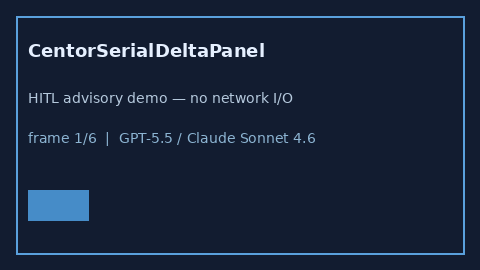

# CentorSerialDeltaPanel Guide



Research-only advisory panel (Safety #271).
Gap vs MDCalc / Centor serial delta-trend panel. Distinct from `CentorStrepPharyngitisScorer` / `HeartSerialDeltaPanel`.

Stack: **GPT-5.5 / Claude Sonnet 4.6 / Gemini 3.x / Kimi K2**.

## Usage

```python
from medagent.safety.centor_serial_delta_panel import (
    CentorSerialDeltaFactors,
    CentorSerialDeltaPanel,
)

findings = CentorSerialDeltaPanel().check(CentorSerialDeltaFactors())
print(findings[0].band, findings[0].rationale)
```

## Safety

RESEARCH USE ONLY. Never modifies medications. No network I/O.
