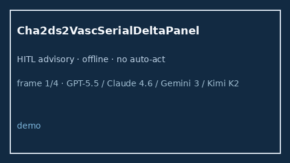

# Cha2ds2VascSerialDeltaPanel Guide



Research-only advisory panel (Safety #270).
Gap vs MDCalc / CHA2DS2-VASc serial delta-trend panel. Distinct from `Cha2ds2VascStrokeRiskScorer` / `HeartSerialDeltaPanel`.

Stack: **GPT-5.5 / Claude Sonnet 4.6 / Gemini 3.x / Kimi K2**.

## Usage

```python
from medagent.safety.cha2ds2_vasc_serial_delta_panel import (
    Cha2ds2VascSerialDeltaFactors,
    Cha2ds2VascSerialDeltaPanel,
)

findings = Cha2ds2VascSerialDeltaPanel().check(Cha2ds2VascSerialDeltaFactors())
print(findings[0].band, findings[0].rationale)
```

## Safety

RESEARCH USE ONLY. Never modifies medications. No network I/O.
