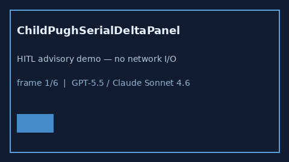

# ChildPughSerialDeltaPanel Guide



Research-only advisory panel (Safety #272).
Gap vs MDCalc / Child-Pugh serial delta-trend panel. Distinct from `ChildPughLiverSeverityScorer` / `MeldNaScorer`.

Stack: **GPT-5.5 / Claude Sonnet 4.6 / Gemini 3.x / Kimi K2**.

## Usage

```python
from medagent.safety.child_pugh_serial_delta_panel import (
    ChildPughSerialDeltaFactors,
    ChildPughSerialDeltaPanel,
)

findings = ChildPughSerialDeltaPanel().check(ChildPughSerialDeltaFactors())
print(findings[0].band, findings[0].rationale)
```

## Safety

RESEARCH USE ONLY. Never modifies medications. No network I/O.
