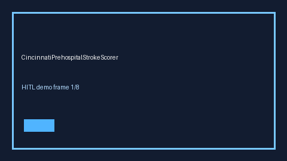

# CincinnatiPrehospitalStrokeScorer Guide



Research-only advisory scorer. Gap vs MDCalc / AHA Cincinnati Prehospital Stroke Scale screen. Distinct from `NihssStrokeScorer` / `RaceStrokeScaleScorer`.

Optional narrative via **GPT-5.5 / Claude Sonnet 4.6 / Gemini 3.x / Kimi K2**.

## Usage

```python
from medagent.safety.cincinnati_prehospital_stroke_scorer import (
    CincinnatiPrehospitalStrokeFactors,
    CincinnatiPrehospitalStrokeScorer,
)

findings = CincinnatiPrehospitalStrokeScorer().check(CincinnatiPrehospitalStrokeFactors())
print(findings[0].band)
```

## Safety

RESEARCH USE ONLY. Never modifies medications. See `SAFETY.md` #234.
