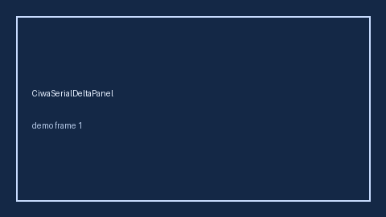

# CiwaSerialDeltaPanel Guide



Research-only Safety #300 serial delta panel.
Offline helper.
Gap vs MDCalc / CIWA-Ar withdrawal serial delta-trend panel. Distinct from `CiwaArWithdrawalScorer` / `RassSerialDeltaPanel`.

Stack: **GPT-5.5 / Claude Sonnet 4.6 / Gemini 3.x / Kimi K2**.

## Usage

```python
from medagent.safety.ciwa_serial_delta_panel import (
    CiwaSerialDeltaFactors,
    CiwaSerialDeltaPanel,
)

findings = CiwaSerialDeltaPanel().check(CiwaSerialDeltaFactors())
print(findings[0].band, findings[0].rationale)
```

## Safety

Advisory only. No network I/O. Never auto-acts. Humans decide.
