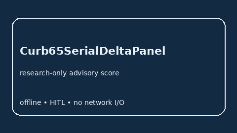

# Curb65SerialDeltaPanel Guide



Research-only advisory serial-delta panel. Gap vs MDCalc / CURB-65 serial delta-trend panel.
Distinct from `Curb65PneumoniaScorer` / `Crb65PneumoniaScorer`.

Optional narrative via **GPT-5.5 / Claude Sonnet 4.6 / Gemini 3.x / Kimi K2**.

## Usage

```python
from medagent.safety.curb65_serial_delta_panel import (
    Curb65SerialDeltaFactors,
    Curb65SerialDeltaPanel,
)

findings = Curb65SerialDeltaPanel().check(
    Curb65SerialDeltaFactors(prior_curb_elevated=1, current_curb_rise=1)
)
assert findings[0].rationale
print(findings[0].band, findings[0].score)
```

## Safety

RESEARCH USE ONLY. Advisory score. Never modifies medications. No network I/O.
