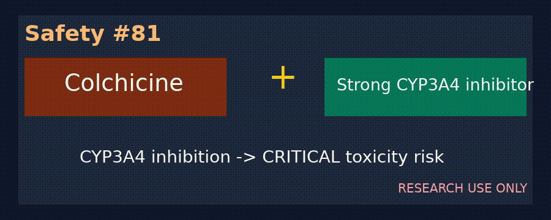

# Cyclosporine + Statin Myopathy / Rhabdomyolysis Checker

*medagent-core — Safety Control #109*



## Overview

`CyclosporineStatinChecker` flags cyclosporine therapy (cyclosporine, ciclosporin, Neoral, Sandimmune, Gengraf) co-prescribed with statins (simvastatin/Zocor or lovastatin/Mevacor — `CRITICAL`; atorvastatin/Lipitor — `HIGH`). Cyclosporine can increase statin exposure and intensify myopathy and rhabdomyolysis risk.

Findings are advisory `CyclosporineStatinRisk` records — **RESEARCH USE ONLY**.
Distinct from statin + fibrate, simvastatin + amiodarone, and digoxin + amiodarone checkers.

## Medication panels

| Class | Agents | Severity |
|---|---|---|
| Primary | `cyclosporine`, `ciclosporin`, `neoral`, `sandimmune`, `gengraf` | — |
| Partner | `simvastatin`, `zocor`, `lovastatin`, `mevacor` | `CRITICAL` |
| Partner | `atorvastatin`, `lipitor` | `HIGH` |

## Quick start

```python
from medagent.models import Medication
from medagent.safety import CyclosporineStatinChecker

findings = CyclosporineStatinChecker().check(
    [Medication(name="cyclosporine"), Medication(name="simvastatin")]
)
```

## Reasoning stack notes

Prefer **GPT-6 Astra**, **Claude Opus 5.5**, **Gemini 4 Argon**, **Kimi K3.1 Pro**.

## See also

- [SAFETY.md §3.109](../../SAFETY.md)
