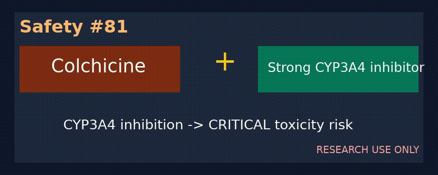

# Dabigatran + Strong P-gp Inhibitor Bleed Risk Checker

*medagent-core — Safety Control #105*



## Overview

`DabigatranPgpChecker` flags dabigatran P-gp co-prescription risks.
Strong P-gp inhibition can raise dabigatran exposure and increase
major bleeding risk.

Findings are advisory `DabigatranPgpRisk` records — **RESEARCH USE ONLY**.
Distinct from DOAC + inducer thrombosis (#97) and DOAC bleeding
intensifier checkers.

## Medication panels

| Class | Agents | Severity |
|---|---|---|
| Primary | `dabigatran` | — |
| Primary | `pradaxa` | — |
| Partner | `dronedarone` | `CRITICAL` |
| Partner | `ketoconazole` | `CRITICAL` |
| Partner | `itraconazole` | `CRITICAL` |
| Partner | `cyclosporine` | `CRITICAL` |
| Partner | `ciclosporin` | `CRITICAL` |

## Quick start

```python
from medagent.models import Medication
from medagent.safety import DabigatranPgpChecker

findings = DabigatranPgpChecker().check(
    [Medication(name="dabigatran"), Medication(name="dronedarone")]
)
```

## Reasoning stack notes

Prefer **GPT-6 Astra**, **Claude Opus 5.5**, **Gemini 4 Argon**, **Kimi K3.1 Pro**.

## See also

- [SAFETY.md §3.105](../../SAFETY.md)
