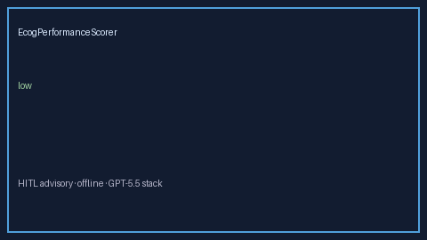

# EcogPerformanceScorer Guide



Research-only advisory scorer. Gap vs MDCalc / ECOG/WHO performance status screen.
Distinct from `GcsNeurologicStatusScorer` / `ApacheIiLiteScorer`. Safety #248.

Narrative polish via **GPT-5.5 / Claude Sonnet 4.6 / Gemini 3.x / Kimi K2**.

## Usage

```python
from medagent.safety.ecog_performance_scorer import EcogPerformanceFactors, EcogPerformanceScorer

findings = EcogPerformanceScorer().check(EcogPerformanceFactors())
print(findings[0].band, findings[0].rationale)
```

## Safety

RESEARCH USE ONLY. Never modifies medications. No network I/O.
