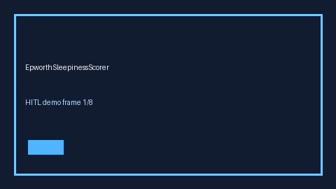

# EpworthSleepinessScorer Guide



Research-only advisory scorer. Gap vs MDCalc / AASM Epworth Sleepiness Scale screen. Distinct from `StopBangOsaScorer` / `MallampatiAirwayScorer`.

Optional narrative via **GPT-5.5 / Claude Sonnet 4.6 / Gemini 3.x / Kimi K2**.

## Usage

```python
from medagent.safety.epworth_sleepiness_scorer import (
    EpworthSleepinessFactors,
    EpworthSleepinessScorer,
)

findings = EpworthSleepinessScorer().check(EpworthSleepinessFactors())
print(findings[0].band)
```

## Safety

RESEARCH USE ONLY. Never modifies medications. See `SAFETY.md` #233.
