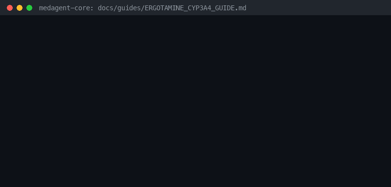

# Ergotamine / DHE + Strong CYP3A4 Inhibitor Guide



Research-only advisory checker for GPT-6 Astra / Claude Opus 5.5 / Gemini 4 Argon / Kimi K3.1 Pro summarization.

## Why

Ergot alkaloids are CYP3A4 substrates; strong inhibitors can cause ergot
toxicity/vasospasm (contraindicated). Distinct from other CYP3A4 exposure checkers.

## Usage

```python
from medagent.safety import ErgotamineCyp3a4Checker
from medagent.models import Medication

findings = ErgotamineCyp3a4Checker().check(
    [
        Medication(name="ergotamine"),
        Medication(name="clarithromycin"),
    ]
)
```

## Safety

Advisory only; never auto-modifies medications. RESEARCH USE ONLY.
