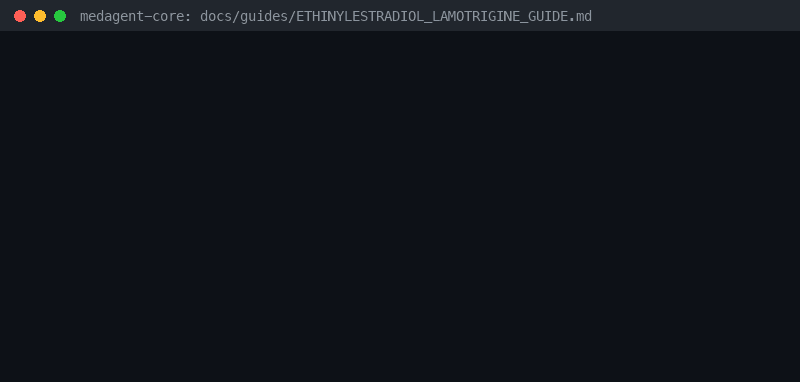

# Ethinylestradiol + Lamotrigine Level Reduction Risk Guide



Research-only advisory checker for GPT-6 Astra / Claude Opus 5.5 / Gemini 4 Argon / Kimi K3.1 Pro summarization.

## Why

Ethinylestradiol-containing combined oral contraceptives induce UGT glucuronidation of lamotrigine, reducing levels and increasing seizure risk.

## Usage

```python
from medagent.safety import EthinylestradiolLamotrigineChecker
from medagent.models import Medication

findings = EthinylestradiolLamotrigineChecker().check(
    [
        Medication(name="lamotrigine"),
        Medication(name="ethinylestradiol"),
    ]
)
```

## Safety

Advisory only; never auto-modifies medications. RESEARCH USE ONLY.
