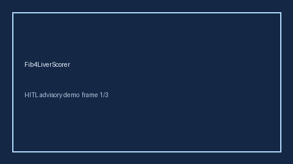

# Fib4LiverScorer Guide



Research-only advisory scorer. Gap vs MDCalc / AASLD FIB-4 liver fibrosis screen. Distinct from `ChildPughLiverSeverityScorer` / `MeldNaScorer`.

Optional narrative via **GPT-5.5 / Claude Sonnet 4.6 / Gemini 3.x / Kimi K2**.

## Usage

```python
from medagent.safety.fib4_liver_scorer import (
    Fib4LiverFactors,
    Fib4LiverScorer,
)

findings = Fib4LiverScorer().check(Fib4LiverFactors())
print(findings[0].band)
```

## Safety

RESEARCH USE ONLY. Never modifies medications. See `SAFETY.md` #238.
