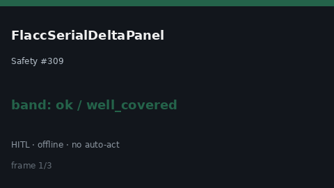

# FlaccSerialDeltaPanel Guide



Research-only Safety #309 serial delta panel.
Offline helper.
Gap vs MDCalc / FLACC pediatric pain serial delta-trend panel. Distinct from `RassSerialDeltaPanel` / `FourAtSerialDeltaPanel`.

Stack: **GPT-6.1 / Claude Sonnet 5.5 / Gemini 3.x / Kimi K3**.

## Usage

```python
from medagent.safety.flacc_serial_delta_panel import (
    FlaccSerialDeltaFactors,
    FlaccSerialDeltaPanel,
)

findings = FlaccSerialDeltaPanel().check(FlaccSerialDeltaFactors())
print(findings[0].band, findings[0].rationale)
```

## Safety

RESEARCH USE ONLY. Never modifies medications. See `SAFETY.md` #309.
