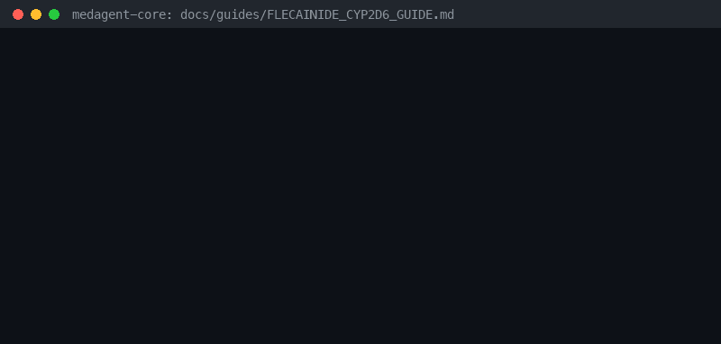

# Flecainide + Strong CYP2D6 Inhibitor Risk Guide



Research-only advisory checker for GPT-6 Astra / Claude Opus 5.5 / Gemini 4 Argon / Kimi K3.1 Pro summarization.

## Why

Flecainide is a CYP2D6 substrate; strong CYP2D6 inhibitors raise flecainide levels and proarrhythmia risk.

## Usage

```python
from medagent.safety import FlecainideCyp2d6Checker
from medagent.models import Medication

findings = FlecainideCyp2d6Checker().check(
    [
        Medication(name="flecainide"),
        Medication(name="fluoxetine"),
    ]
)
for finding in findings:
    print(finding.agent, finding.partner_agent, finding.severity)
```

## Safety

Advisory only; never auto-modifies medications. RESEARCH USE ONLY.
