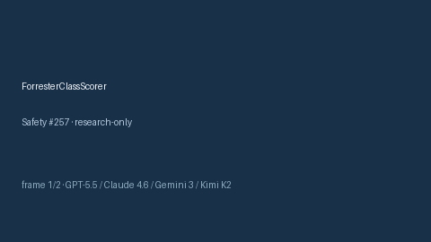

# ForresterClassScorer Guide



Research-only advisory score (Safety #257).
Gap vs MDCalc / Killip-Forrester hemodynamic class screen. Distinct from `GraceAcsScorer` / `HeartScoreAcsScorer`.

Optional narrative via **GPT-5.5 / Claude Sonnet 4.6 / Gemini 3.x / Kimi K2**.

## Usage

```python
from medagent.safety.forrester_class_scorer import (
    ForresterClassFactors,
    ForresterClassScorer,
)

findings = ForresterClassScorer().check(ForresterClassFactors())
assert findings[0].rationale
print(findings[0].band)
```

## Safety

RESEARCH USE ONLY. Advisory. Never modifies medications. No network I/O.
