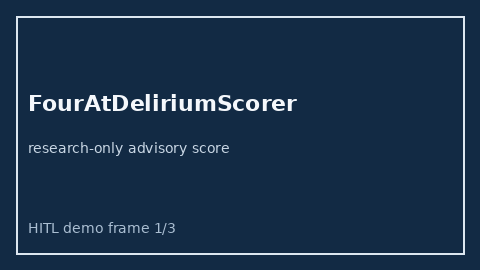

# FourAtDeliriumScorer Guide



Research-only advisory scorer.
Gap vs MDCalc / 4AT rapid delirium screen. Distinct from `CamIcuDeliriumScorer` / `CiwaArWithdrawalScorer`.

Optional narrative via **GPT-5.5 / Claude Sonnet 4.6 / Gemini 3.x / Kimi K2**.

## Usage

```python
from medagent.safety.four_at_delirium_scorer import FourAtDeliriumFactors, FourAtDeliriumScorer

findings = FourAtDeliriumScorer().check(FourAtDeliriumFactors())
assert findings[0].rationale
```

## Safety

RESEARCH USE ONLY. Never modifies medications. No network I/O.
