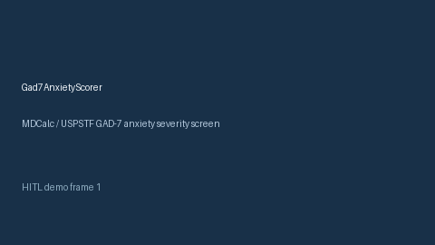

# Gad7AnxietyScorer Guide



Research-only advisory scorer. Gap vs MDCalc / USPSTF GAD-7 anxiety severity screen. Distinct from `Phq9DepressionScorer` / `EpworthSleepinessScorer`.

Optional narrative via **GPT-5.5 / Claude Sonnet 4.6 / Gemini 3.x / Kimi K2**.

## Usage

```python
from medagent.safety.gad7_anxiety_scorer import (
    Gad7AnxietyFactors,
    Gad7AnxietyScorer,
)

findings = Gad7AnxietyScorer().check(Gad7AnxietyFactors())
print(findings[0].band)
```

## Safety

RESEARCH USE ONLY. Never modifies medications. See `SAFETY.md` #243.
