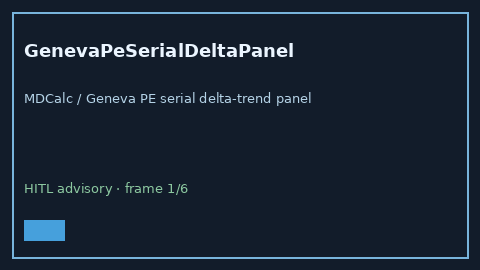

# GenevaPeSerialDeltaPanel Guide



Research-only advisory panel (Safety #266).
Gap vs MDCalc / Geneva PE serial delta-trend panel. Distinct from `RevisedGenevaPeScorer` / `WellsPeSerialDeltaPanel`.

Stack: **GPT-5.5 / Claude Sonnet 4.6 / Gemini 3.x / Kimi K2**.

## Usage

```python
from medagent.safety.geneva_pe_serial_delta_panel import (
    GenevaPeSerialDeltaFactors,
    GenevaPeSerialDeltaPanel,
)

findings = GenevaPeSerialDeltaPanel().check(
    GenevaPeSerialDeltaFactors(
        prior_geneva_elevated=0,
        current_geneva_rise=0,
    )
)
assert findings[0].rationale
```

## Safety

RESEARCH USE ONLY. Advisory only. No network I/O. Never modifies medications.
