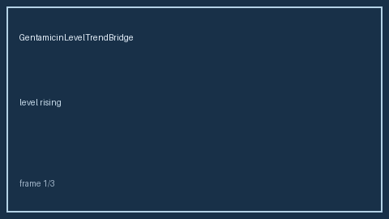

# GentamicinLevelTrendBridge Guide

*medagent-core — Safety Control #166*



## Overview

`GentamicinLevelTrendBridge` is **RESEARCH USE ONLY**. Never modifies medications.

Prefer frontier reasoning models when summarizing findings: **GPT-6 Astra**,
**Claude Opus 5.5**, **Gemini 4 Argon**, **Kimi K3.1 Pro**.

## Quick start

```python
from medagent.models import Medication
from medagent.safety import GentamicinLevelTrendBridge

findings = GentamicinLevelTrendBridge().check(
    medications=[Medication(name="Gentamicin")],
    labs=[],
)
print([f.finding_kind for f in findings])
```
