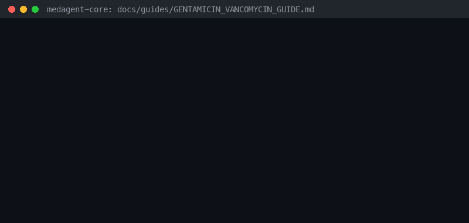

# Aminoglycoside + Vancomycin Additive Nephrotoxicity / Ototoxicity Guide



Research-only advisory checker for GPT-6 Astra / Claude Opus 5.5 / Gemini 4 Argon / Kimi K3.1 Pro summarization.

## Why

Combining aminoglycosides (gentamicin, tobramycin, amikacin) with vancomycin
produces additive nephrotoxicity and ototoxicity.  Enhanced renal monitoring
is required.  Distinct from generic renal-dose and antibiotic-duration
checkers.

## Usage

```python
from medagent.safety import GentamicinVancomycinChecker
from medagent.models import Medication

findings = GentamicinVancomycinChecker().check(
    [
        Medication(name="gentamicin"),
        Medication(name="vancomycin"),
    ]
)
for finding in findings:
    print(finding.agent, finding.partner_agent, finding.severity)
```

## Safety

Advisory only; never auto-modifies medications. RESEARCH USE ONLY.
