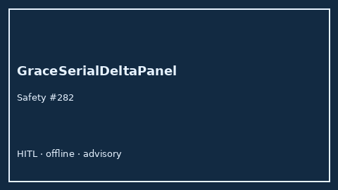

# GraceSerialDeltaPanel Guide



Research-only Safety #282 serial delta panel.
Gap vs MDCalc / GRACE ACS serial delta-trend panel. Distinct from `GraceAcsScorer` / `HeartSerialDeltaPanel`.

Stack: **GPT-5.5 / Claude Sonnet 4.6 / Gemini 3.x / Kimi K2**.

## Usage

```python
from medagent.safety.grace_serial_delta_panel import GraceSerialDeltaFactors, GraceSerialDeltaPanel

findings = GraceSerialDeltaPanel().check(GraceSerialDeltaFactors())
print(findings[0].band)
```

## Safety

RESEARCH USE ONLY. Never modifies medications. No network I/O.
