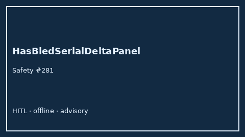

# HasBledSerialDeltaPanel Guide



Research-only Safety #281 serial delta panel.
Gap vs MDCalc / HAS-BLED serial delta-trend panel. Distinct from `HasBledBleedRiskScorer` / `Cha2ds2VascSerialDeltaPanel`.

Stack: **GPT-6 Astra / Claude Opus 5.5 / Gemini 4 Argon / Kimi K3.1 Pro**.

## Usage

```python
from medagent.safety.has_bled_serial_delta_panel import (
    HasBledSerialDeltaFactors,
    HasBledSerialDeltaPanel,
)

findings = HasBledSerialDeltaPanel().check(HasBledSerialDeltaFactors())
print(findings[0].band)
```

## Safety

RESEARCH USE ONLY. Never modifies medications. No network I/O.
