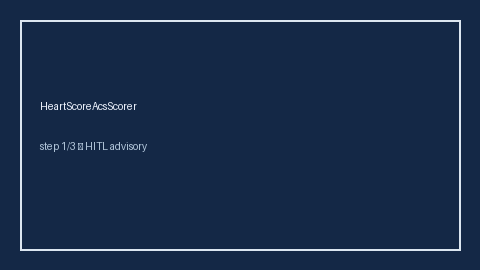

# HeartScoreAcsScorer Guide



Research-only advisory clinical score. Never modifies medications.

Prefer **GPT-6 Astra / Claude Opus 5.5 / Gemini 4 Argon / Kimi K3.1 Pro** for narratives.

Distinct from `Cha2ds2VascStrokeRiskScorer / HasBledBleedRiskScorer`.

## Usage

```python
from medagent.safety.heart_score_acs_scorer import HeartScoreFactors, HeartScoreAcsScorer

findings = HeartScoreAcsScorer().check(HeartScoreFactors())
assert findings[0].rationale.startswith("RESEARCH USE ONLY")
```
