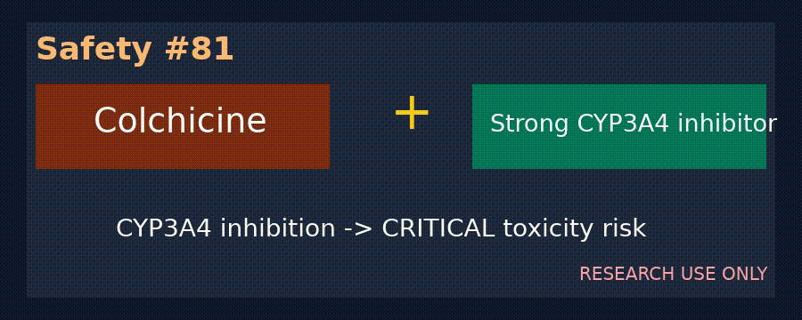

# Ivabradine + Strong CYP3A4 Inhibitor Bradycardia Checker

*medagent-core — Safety Control #106*



## Overview

`IvabradineCyp3a4Checker` flags ivabradine CYP3A4 co-prescription risks.
Strong CYP3A4 inhibition can elevate ivabradine exposure and
precipitate severe bradycardia / conduction disturbances.

Findings are advisory `IvabradineCyp3a4Risk` records — **RESEARCH USE ONLY**.
Distinct from general QT screens and other CYP3A4 exposure checkers
(fentanyl/quetiapine/colchicine).

## Medication panels

| Class | Agents | Severity |
|---|---|---|
| Primary | `ivabradine` | — |
| Primary | `corlanor` | — |
| Partner | `ketoconazole` | `CRITICAL` |
| Partner | `clarithromycin` | `CRITICAL` |
| Partner | `ritonavir` | `CRITICAL` |
| Partner | `itraconazole` | `CRITICAL` |
| Partner | `nefazodone` | `CRITICAL` |

## Quick start

```python
from medagent.models import Medication
from medagent.safety import IvabradineCyp3a4Checker

findings = IvabradineCyp3a4Checker().check(
    [Medication(name="ivabradine"), Medication(name="ketoconazole")]
)
```

## Reasoning stack notes

Prefer **GPT-6 Astra**, **Claude Opus 5.5**, **Gemini 4 Argon**, **Kimi K3.1 Pro**.

## See also

- [SAFETY.md §3.106](../../SAFETY.md)
