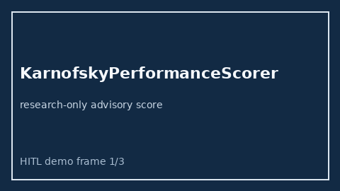

# KarnofskyPerformanceScorer Guide



Research-only advisory scorer.
Gap vs MDCalc / Karnofsky Performance Status screen. Distinct from `EcogPerformanceScorer` / `BarthelAdlScorer`.

Optional narrative via **GPT-5.5 / Claude Sonnet 4.6 / Gemini 3.x / Kimi K2**.

## Usage

```python
from medagent.safety.karnofsky_performance_scorer import (
    KarnofskyPerformanceFactors,
    KarnofskyPerformanceScorer,
)

findings = KarnofskyPerformanceScorer().check(KarnofskyPerformanceFactors())
assert findings[0].rationale
```

## Safety

RESEARCH USE ONLY. Never modifies medications. No network I/O.
