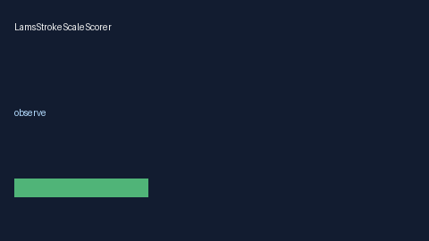

# LamsStrokeScaleScorer Guide



Research-only advisory scorer. Never modifies medications. Gap vs MDCalc / AHA LAMS large-vessel occlusion screen.

Optional narrative via **GPT-6 Astra / Claude Opus 5.5 / Gemini 4 Argon / Kimi K3.1 Pro**.

Distinct from `NihssStrokeScorer / RaceStrokeScaleScorer`.

## Usage

```python
from medagent.safety.lams_stroke_scale_scorer import (
    LamsStrokeScaleFactors,
    LamsStrokeScaleScorer,
)

findings = LamsStrokeScaleScorer().check(LamsStrokeScaleFactors())
print(findings[0].band, findings[0].rationale)
```
