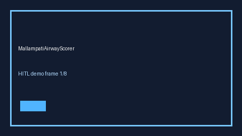

# MallampatiAirwayScorer Guide



Research-only advisory scorer. Gap vs MDCalc / ASA Mallampati airway class screen. Distinct from `StopBangOsaScorer` / `GcsNeurologicStatusScorer`.

Optional narrative via **GPT-5.5 / Claude Sonnet 4.6 / Gemini 3.x / Kimi K2**.

## Usage

```python
from medagent.safety.mallampati_airway_scorer import MallampatiAirwayFactors, MallampatiAirwayScorer

findings = MallampatiAirwayScorer().check(MallampatiAirwayFactors())
print(findings[0].band)
```

## Safety

RESEARCH USE ONLY. Never modifies medications. See `SAFETY.md` #232.
