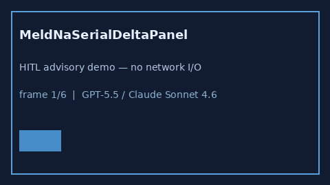

# MeldNaSerialDeltaPanel Guide



Research-only advisory panel (Safety #273).
Gap vs MDCalc / MELD-Na serial delta-trend panel. Distinct from `MeldNaScorer` / `ChildPughLiverSeverityScorer`.

Stack: **GPT-5.5 / Claude Sonnet 4.6 / Gemini 3.x / Kimi K2**.

## Usage

```python
from medagent.safety.meld_na_serial_delta_panel import (
    MeldNaSerialDeltaFactors,
    MeldNaSerialDeltaPanel,
)

findings = MeldNaSerialDeltaPanel().check(MeldNaSerialDeltaFactors())
print(findings[0].band, findings[0].rationale)
```

## Safety

RESEARCH USE ONLY. Never modifies medications. No network I/O.
