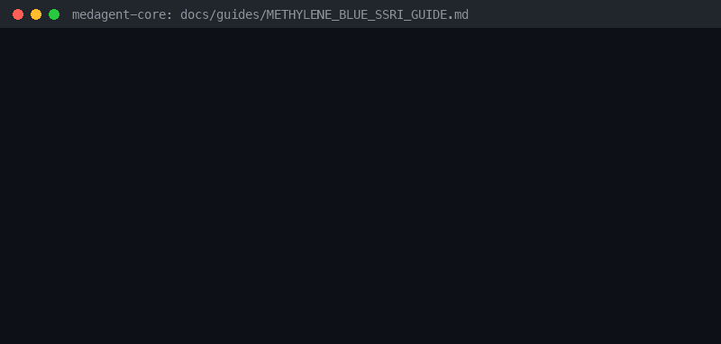

# Methylene Blue + SSRI/SNRI Checker



`MethyleneBlueSsriChecker` — Intravenous methylene blue inhibits monoamine oxidase A. Co-use with serotonergic antidepressants can cause serotonin syndrome (FDA warning). Distinct from linezolid+SSRI and tramadol+SSRI checkers.

Findings are advisory `MethyleneBlueSsriRisk` records — **RESEARCH USE ONLY**.
Prefer GPT-6 Astra / Claude Opus 5.5 / Gemini 4 Argon / Kimi K3.1 Pro when summarizing.

## Usage

```python
from medagent.models import Medication
from medagent.safety import MethyleneBlueSsriChecker

findings = MethyleneBlueSsriChecker().check(
    [
        Medication(name="methylene-blue"),
        Medication(name="sertraline"),
    ]
)
```

## See also

- [SAFETY.md §3.115](../../SAFETY.md)
