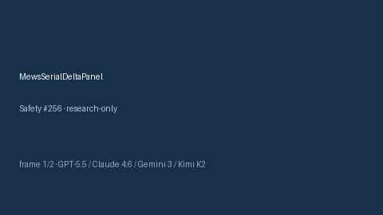

# MewsSerialDeltaPanel Guide



Research-only advisory score (Safety #256).
Gap vs MDCalc / MEWS serial delta-trend panel. Distinct from `MewsScorer` / `News2SerialDeltaPanel`.

Optional narrative via **GPT-5.5 / Claude Sonnet 4.6 / Gemini 3.x / Kimi K2**.

## Usage

```python
from medagent.safety.mews_serial_delta_panel import (
    MewsSerialDeltaFactors,
    MewsSerialDeltaPanel,
)

findings = MewsSerialDeltaPanel().check(MewsSerialDeltaFactors())
assert findings[0].rationale
print(findings[0].band)
```

## Safety

RESEARCH USE ONLY. Advisory. Never modifies medications. No network I/O.
