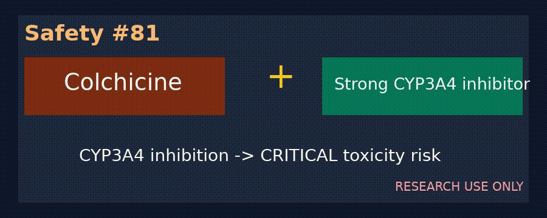

# Midazolam + Strong CYP3A4 Inhibitor Sedation Checker

*medagent-core — Safety Control #108*



## Overview

`MidazolamCyp3a4Checker` flags midazolam CYP3A4 co-prescription risks.
Strong CYP3A4 inhibition can elevate midazolam exposure and prolong
sedation / respiratory depression.

Findings are advisory `MidazolamCyp3a4Risk` records — **RESEARCH USE ONLY**.
Distinct from fentanyl, quetiapine, and ivabradine CYP3A4 exposure checkers.

## Medication panels

| Class | Agents | Severity |
|---|---|---|
| Primary | `midazolam` | — |
| Primary | `versed` | — |
| Partner | `ketoconazole` | `CRITICAL` |
| Partner | `clarithromycin` | `CRITICAL` |
| Partner | `ritonavir` | `CRITICAL` |
| Partner | `itraconazole` | `CRITICAL` |
| Partner | `nefazodone` | `CRITICAL` |

## Quick start

```python
from medagent.models import Medication
from medagent.safety import MidazolamCyp3a4Checker

findings = MidazolamCyp3a4Checker().check(
    [Medication(name="midazolam"), Medication(name="ketoconazole")]
)
```

## Reasoning stack notes

Prefer **GPT-6 Astra**, **Claude Opus 5.5**, **Gemini 4 Argon**, **Kimi K3.1 Pro**.

## See also

- [SAFETY.md §3.108](../../SAFETY.md)
