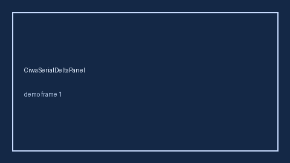

# MocaSerialDeltaPanel Guide



Research-only Safety #303 serial delta panel.
Offline helper.
Gap vs MDCalc / MoCA cognition serial delta-trend panel. Distinct from `FourScoreSerialDeltaPanel` / `GcsSerialDeltaPanel`.

Stack: **GPT-5.5 / Claude Sonnet 4.6 / Gemini 3.x / Kimi K2**.

## Usage

```python
from medagent.safety.moca_serial_delta_panel import (
    MocaSerialDeltaFactors,
    MocaSerialDeltaPanel,
)

findings = MocaSerialDeltaPanel().check(MocaSerialDeltaFactors())
print(findings[0].band, findings[0].rationale)
```

## Safety

Advisory only. No network I/O. Never auto-acts. Humans decide.
