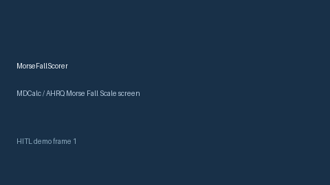

# MorseFallScorer Guide



Research-only advisory scorer. Gap vs MDCalc / AHRQ Morse Fall Scale screen. Distinct from `News2EarlyWarningScorer` / `PewsEarlyWarningScorer`.

Optional narrative via **GPT-5.5 / Claude Sonnet 4.6 / Gemini 3.x / Kimi K2**.

## Usage

```python
from medagent.safety.morse_fall_scorer import (
    MorseFallFactors,
    MorseFallScorer,
)

findings = MorseFallScorer().check(MorseFallFactors())
print(findings[0].band)
```

## Safety

RESEARCH USE ONLY. Never modifies medications. See `SAFETY.md` #241.
