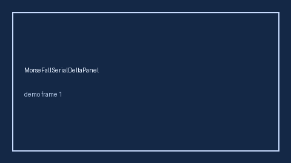

# MorseFallSerialDeltaPanel Guide



Research-only Safety #299 serial delta panel.
Offline helper.
Gap vs MDCalc / Morse Fall Scale serial delta-trend panel. Distinct from `MorseFallScorer` / `BradenPressureScorer`.

Stack: **GPT-5.5 / Claude Sonnet 4.6 / Gemini 3.x / Kimi K2**.

## Usage

```python
from medagent.safety.morse_fall_serial_delta_panel import (
    MorseFallSerialDeltaFactors,
    MorseFallSerialDeltaPanel,
)

findings = MorseFallSerialDeltaPanel().check(MorseFallSerialDeltaFactors())
print(findings[0].band, findings[0].rationale)
```

## Safety

Advisory only. No network I/O. Never auto-acts. Humans decide.
