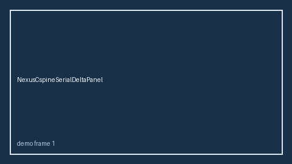

# NexusCspineSerialDeltaPanel Guide



Research-only serial delta panel (Safety #285).
Gap vs MDCalc / NEXUS C-spine serial delta-trend panel. Distinct from `NexusCspineScorer` / `CanadianCspineRuleScorer`.

Stack: **GPT-5.5 / Claude Sonnet 4.6 / Gemini 3.x / Kimi K2**.

## Usage

```python
from medagent.safety.nexus_cspine_serial_delta_panel import (
    NexusCspineSerialDeltaFactors,
    NexusCspineSerialDeltaPanel,
)

findings = NexusCspineSerialDeltaPanel().check(NexusCspineSerialDeltaFactors())
print(findings[0].band, findings[0].rationale)
```

## Safety

RESEARCH USE ONLY. Advisory. No network I/O. Never modifies medications.
